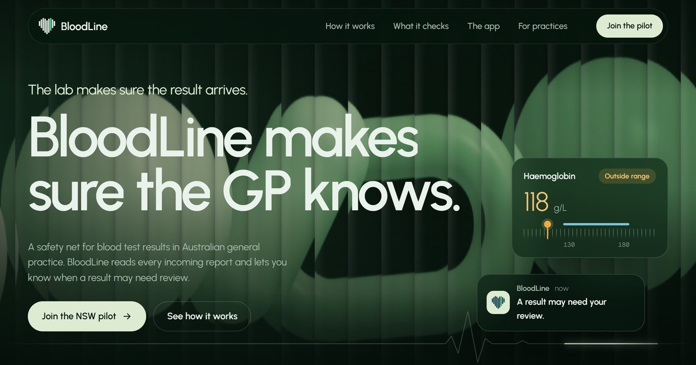
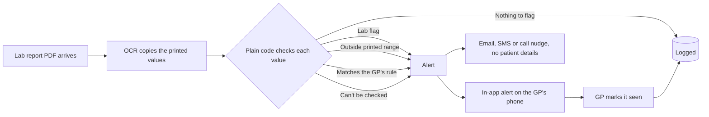
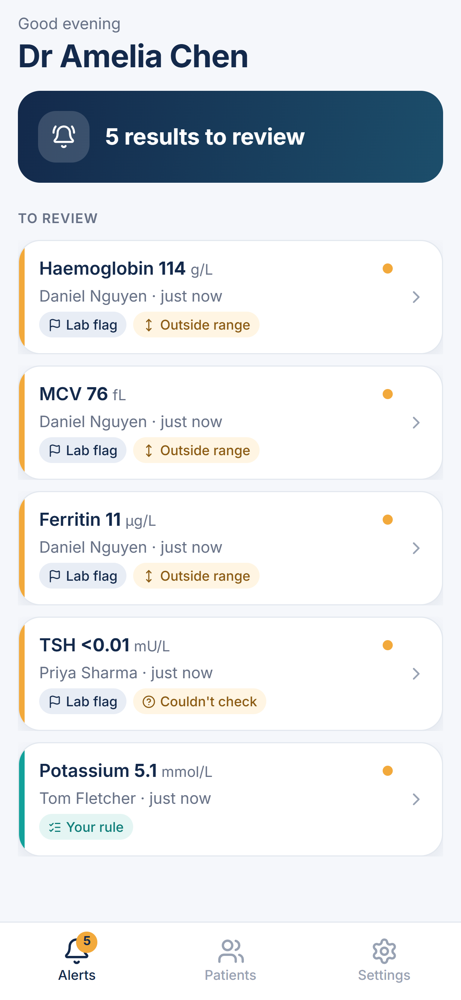
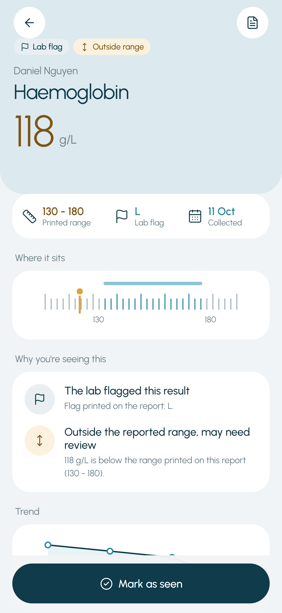
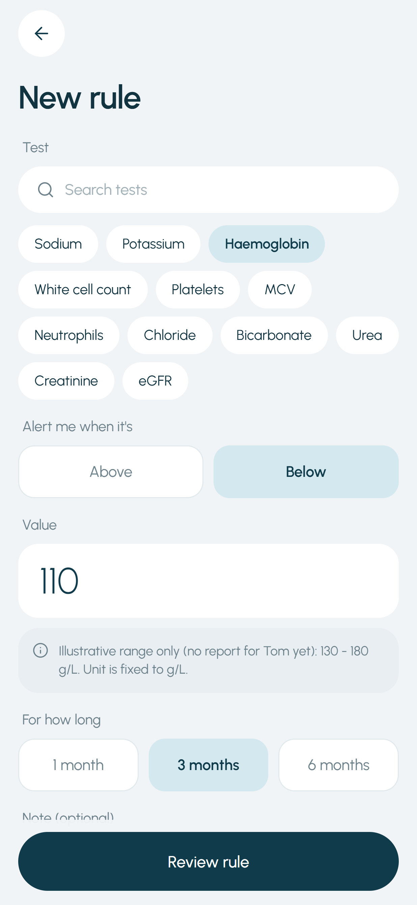
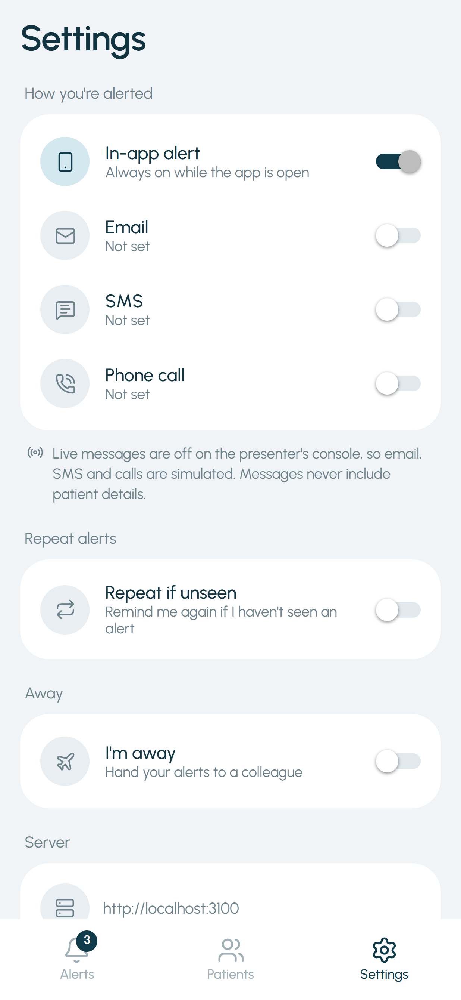

<p align="center">
  <picture>
    <source media="(prefers-color-scheme: dark)" srcset="docs/assets/logo-dark.svg">
    
  </picture>
</p>

<h1 align="center">BloodLine</h1>

<p align="center"><b>The lab makes sure the result arrives. BloodLine makes sure the GP knows.</b></p>

<p align="center">
  <a href="https://ar13x3.github.io/Bloodline/">Website</a> ·
  <a href="https://ar13x3.github.io/Bloodline/docs/PRD.html">Product requirements</a> ·
  <a href="https://ar13x3.github.io/Bloodline/docs/pitch.html">Pitch numbers</a> ·
  <a href="https://ar13x3.github.io/Bloodline/docs/system-design.html">System design</a> ·
  <a href="#the-team">The team</a>
</p>

[](https://ar13x3.github.io/Bloodline/)

BloodLine is a safety net for blood test results in Australian general practice. It reads every incoming pathology report and alerts the GP when a result may need review:

- the **lab flagged** the result,
- the value is **outside the range printed on that patient's report**, or
- it matches a **rule the GP set** for that patient.

If a value can't be checked cleanly (for example "<0.01"), BloodLine says so instead of staying silent.

OCR only copies what's printed on the report; plain, deterministic code does every check. BloodLine doesn't diagnose, decide urgency or replace the GP's usual review, and labs still phone through critical results.

> **This is a hackathon prototype.** All data in this repo is synthetic. BloodLine hasn't been through regulatory review and is not for clinical use.

## Why it matters

- Across 19 ambulatory-care studies, up to 62% of lab results weren't followed up (Callen et al., 2012; US studies).
- Since 1 July 2026, pathology reports go to My Health Record by default, so a patient may read a result before anyone at the practice has acted on it.
- The RACGP's 6th edition Standards (26 August 2026) keep a dedicated criterion for follow-up systems (CG6).

The full evidence, market sizing and sources are in the [PRD](https://ar13x3.github.io/Bloodline/docs/PRD.html) and [pitch numbers](https://ar13x3.github.io/Bloodline/docs/pitch.html).

## How it works



1. **The report arrives.** In the demo, a presenter console sends synthetic lab report PDFs. In production, BloodLine would read results from the practice software, starting with Best Practice through Halo Connect.
2. **OCR copies the values**, exactly as printed. Nothing is interpreted.
3. **Deterministic code checks each value** against the lab flag, the printed range and the GP's own rules. The same input always gives the same answer.
4. **The GP is alerted** in the Android app. Email, SMS and a phone call can nudge them to open it, and those messages never carry patient details. Repeat nudges are optional if an alert stays unseen.
5. **The GP reviews the result** next to the original report and taps **Mark as seen**. Every check, message and action goes into the audit trail.

## Screenshots

| Alerts | Alert detail | New rule | Settings |
|---|---|---|---|
|  |  |  |  |

More in [docs/screenshots](docs/screenshots).

## What's in the repo

| Folder | What it is |
|---|---|
| [`web/`](web) | Next.js app: the API, the presenter console (upload, live pipeline, OCR reading, delivery, records) and a local SQLite database |
| [`mobile/`](mobile) | Expo (React Native) Android app for the GP: alerts, alert detail, patient rules, settings |
| [`Website/`](Website) | The marketing site (Vite + GSAP), published to [GitHub Pages](https://ar13x3.github.io/Bloodline/). See [Website/README.md](Website/README.md) |
| [`docs/`](docs) | Product requirements ([PRD.md](docs/PRD.md)), pitch numbers, system design and screenshots |

**Built with:** Next.js, React and TypeScript; Node's built-in SQLite; Expo and React Native; OCR through OpenRouter; Resend (email) and Twilio (SMS and calls); Vite, GSAP and Lenis for the website.

## One-time setup

1. **Web app**

   ```bash
   cd web
   npm install
   cp .env.example .env.local
   ```

   Fill in `web/.env.local`:

   | Variable | What for |
   |---|---|
   | `OPENROUTER_API_KEY` | OCR of report PDFs (about $0.0003 per report) |
   | `RESEND_API_KEY`, `EMAIL_FROM` | Email alerts. `onboarding@resend.dev` only delivers to your Resend account's own email |
   | `TWILIO_ACCOUNT_SID`, `TWILIO_AUTH_TOKEN`, `TWILIO_FROM_NUMBER` | SMS and phone-call alerts. A trial account can only reach verified numbers and can't send custom SMS text |
   | `DEMO_GP_EMAIL`, `DEMO_GP_MOBILE` | Where Dr Amelia Chen's (the demo GP's) alerts go. Mobile in `+61…` format |
   | `VOICE_MESSAGE_URL` | Optional: a public MP3/WAV played on calls (e.g. from Twilio Assets). Without it, calls use a computer voice |

   Every key is optional. Without OCR, the simulator's printed values are used; without the messaging keys, every email, SMS and call is logged as "simulated".

   Then create the synthetic database:

   ```bash
   npm run db:reset
   ```

2. **Mobile app**

   ```bash
   cd mobile
   npm install
   ```

   Install **Expo Go** from the Play Store on the demo Android phone (or use an Android emulator).

3. **Tunnel** (so the phone can reach the laptop from any network). Install Cloudflare's free tunnel tool:

   ```bash
   winget install --id Cloudflare.cloudflared
   ```

4. **Optional:** mirror the phone onto the laptop screen with [scrcpy](https://github.com/Genymobile/scrcpy) (`winget install --id Genymobile.scrcpy`), so the audience sees the phone and the console side by side.

## Running the demo

Open three terminals.

1. **Web app and console**

   ```bash
   cd web
   npm run dev
   ```

   Open http://localhost:3100. For the most reliable stage run, use `npm run demo` (production build) instead.

2. **Tunnel**

   ```bash
   cd web
   npm run tunnel
   ```

   Copy the `https://….trycloudflare.com` address it prints. It changes every time you start the tunnel.

3. **Phone app**

   ```bash
   cd mobile
   npx expo start
   ```

   Scan the QR code with Expo Go (or press `a` for the emulator). If the venue Wi-Fi blocks device-to-device traffic, use `npm run start:tunnel` instead. In the app, tap the server address on the sign-in screen, paste the tunnel address, then sign in as **Dr Amelia Chen**. Keep the app open on stage.

## Demo script (about 3 minutes)

1. **Set up:** console on the projector, phone mirrored beside it, signed in as Dr Chen. In the console's **Delivery** panel, switch on Email, SMS and Phone call. Then switch on **Live messages** in the header (it asks for confirmation).
2. **Upload:** drop a lab report PDF into "Send a lab report" (or use "Download a sample report" first), choose the patient, and click **Send to BloodLine**.
3. **Watch:** the live pipeline lights up (report → OCR → checks → alert → app, email, SMS, call). The OCR reading panel shows the PDF being read and each value popping in with BloodLine's verdict.
4. **The phone:** the in-app alert arrives with a buzz, the SMS lands, and the phone rings. Open the alert to show the reasons, the printed range bar and the trend, then **Mark as seen**. The console's activity feed shows it as seen.
5. **GP rules:** on the phone, open Patients → Tom Fletcher → New rule (or show the existing potassium rule), then send the **Matches a GP rule** quick scenario: potassium 5.1 is inside the printed range and unflagged, but still alerts because of the GP's own rule.
6. **Safety touches:** send **Can't be checked** ("<0.01" isn't a plain number, so BloodLine says so instead of staying silent), and **Send duplicate** (ignored). Point out the audit trail in Records.

Reset between rehearsals with **Reset demo**. Saved OCR readings are kept, so repeat runs are instant and free.

## Development

```bash
cd web
npm test           # 84 tests: range parsing, validation, checks, routing, repeats, pipeline
npx tsc --noEmit
npm run lint

cd ../mobile
npx tsc --noEmit
npx expo-doctor
```

Nothing real is sent unless **Live messages** is switched on in the console and the provider keys are set. Otherwise every email, SMS and call is logged as "simulated".

## The team

BloodLine was designed and built by:

| | |
|---|---|
| **Toufiq Ahmed** | [LinkedIn](https://www.linkedin.com/in/toufiq-ahmed-10b5a3275) |
| **Charles Liu** | [LinkedIn](https://www.linkedin.com/in/charles-liu-b42092351/) |
| **Arya Prakash** | [LinkedIn](https://www.linkedin.com/in/arya-prakash-697188380/) |
| **Adrian Le** | [LinkedIn](https://www.linkedin.com/in/adrianle06/) |

Want to talk? Find us on the [team page](https://ar13x3.github.io/Bloodline/connect).

## Credits

Product, design and code by the BloodLine team above.

Built on open-source work we're grateful for, including [Next.js](https://nextjs.org), [Expo](https://expo.dev) and [React Native](https://reactnative.dev), [GSAP](https://gsap.com), [Lenis](https://lenis.darkroom.engineering), [Vite](https://vite.dev), [Radix UI](https://www.radix-ui.com), [shadcn/ui](https://ui.shadcn.com), [Lucide](https://lucide.dev) icons, [pdf-lib](https://pdf-lib.js.org), [TanStack Query](https://tanstack.com/query) and [Zod](https://zod.dev). Typefaces: [Urbanist](https://fonts.google.com/specimen/Urbanist), [Atkinson Hyperlegible](https://fonts.google.com/specimen/Atkinson+Hyperlegible) and [Geist Mono](https://vercel.com/font). Evidence and market figures cite their sources in the [PRD](docs/PRD.md#20-sources).

## Contributing

Contributions are welcome. Start with [CONTRIBUTING.md](CONTRIBUTING.md), and please follow our [Code of Conduct](CODE_OF_CONDUCT.md). Report security problems privately as described in [SECURITY.md](SECURITY.md). Accessibility status and known gaps are in [ACCESSIBILITY.md](ACCESSIBILITY.md).

## License

BloodLine is open source under the [Apache License 2.0](LICENSE). The website's background video (made with Halation) and the BloodLine name and logo aren't covered; [NOTICE](NOTICE) has the details.
