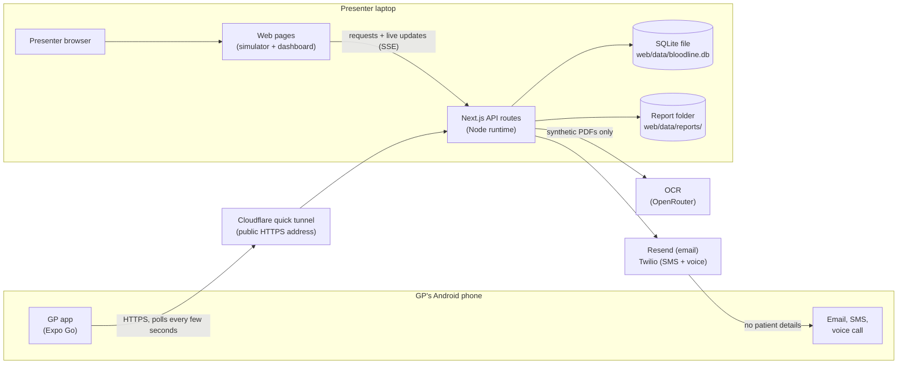
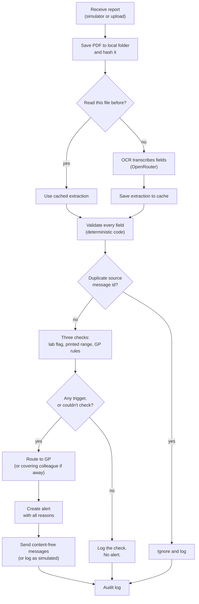
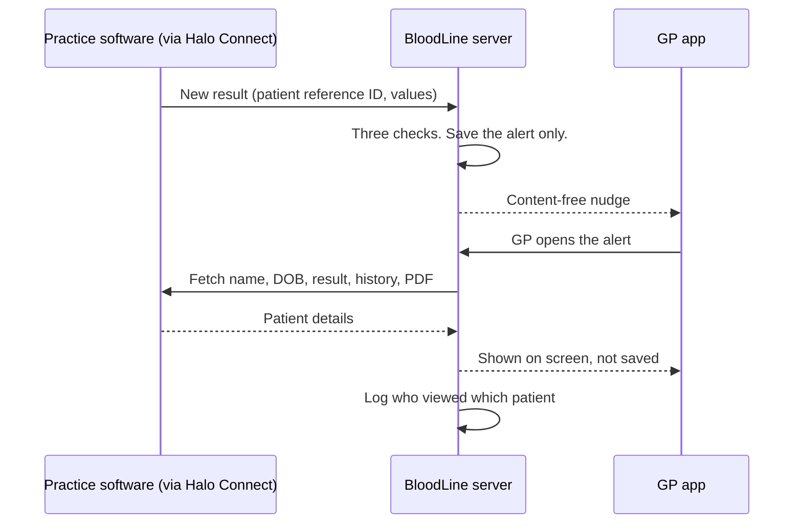

# BloodLine — Product Requirements Document

> **Synthetic data only.** This PRD describes a demo built on synthetic data. It is not legal advice. It is not a validated clinical risk assessment. No real clinical thresholds appear here. Placeholders such as "above X mmol/L" stand in for real values.

---

## 1. Document info

| Field | Value |
|---|---|
| Product | BloodLine |
| Document | Product Requirements Document (PRD) |
| Version | 0.1 |
| Date | 2026-10-11 |
| Status | Draft |
| Owners | TBD |
| Audience | Founding team, build team, investors |
| Covers | 12-hour hackathon/investor demo (synthetic data) and the production direction |

### How to read this document

| Label | Meaning |
|---|---|
| **[S#]** | Verified fact from a listed source. See §20. |
| **Decision** | Agreed with the founders. A choice, not a fact about the world. |
| **Assumption (A#)** | Something we believe but have not tested. |
| **Hypothesis (H#)** | A product or business bet we plan to test. |
| **Proposed** | A design suggestion made in this PRD. Needs team sign-off. |
| **Target** | A goal we will measure. Not a guarantee. |
| **Q#** | Open question. All are listed in §17.4. |

---

## 2. Summary

BloodLine is a safety-net alerting product for Australian GPs. It starts with independent GP practices in NSW.

It reads incoming blood test (pathology) reports. It lets the GP know when a result may need review.

BloodLine alerts on exactly three things:

1. The lab flagged the result as abnormal.
2. The value is outside the reference range printed on that patient's report.
3. The value matches a rule the GP set for that patient.

If BloodLine can't check a result cleanly, it tells the GP. It never stays silent.

**What BloodLine does not do.** It does not diagnose. It does not decide urgency. It does not automate follow-up. It does not replace the GP's normal inbox review. It does not replace the lab's phone call for critical results.

> "We're not making a decision, it's just letting the GP know in case something is wrong." — the founders

**Tagline:** "The lab makes sure the result arrives. BloodLine makes sure the GP knows." (Changed from "makes sure someone acts on it", which overstated what the product does; see Q31 and §17.5.)

**The demo.** A 12-hour hackathon build for investors. Everything runs on the presenter's laptop. A web page labelled "Practice system (simulated)" sends synthetic lab report PDFs. OCR transcribes each PDF into fields. Plain, deterministic code checks those fields. The GP's Android app shows the alert. Email, SMS and a voice call tell the GP to open the app, with no patient details. The GP reviews the result next to the original report and taps "Seen". A web dashboard shows every check, message and action.

**The production direction.** BloodLine would read results from the practice software, starting with Best Practice through Halo Connect. Labs change nothing: "we plug in where results already land". In production, results arrive as structured data (HL7) alongside PDFs. So OCR becomes a fallback, not the main path. Before the final product, OCR moves to a secure service (§13.7).

---

## 3. Problem and evidence

### 3.1 The problem

Labs deliver results to the practice. For critical results, the lab also phones. After that, follow-up depends on the GP's inbox review and the practice's own processes. Some results are never acted on. When that happens, patients can be harmed.

BloodLine adds one more safety net. It does not change who is responsible. The GP still reviews every result.

### 3.2 Evidence

| Finding | Source | Caveat |
|---|---|---|
| A 2012 systematic review (Callen et al., *Journal of General Internal Medicine*) of 19 ambulatory-care studies found 6.8%–62% of lab results and 1.0%–35.7% of radiology results were not followed up. | [S1] [S2] | All 19 studies were from the US. |
| Reported harms included missed cancer diagnoses, hospital presentations after missed high potassium, and under-treatment after missed thyroid results. | [S1] [S2] | US settings. |
| A US hospital reminder system cut incomplete follow-up of imaging findings from 29.3% to 16%. It found nine clinically important diagnoses among 199 patients. | [S3] | Imaging, not pathology. Supporting evidence only. |

**Australian data is thin.** We have not found Australian figures for missed pathology follow-up.

- **A1.** Missed follow-up of pathology results happens often enough in Australian general practice to matter to GPs and practice managers. *To test in 30 practice interviews.*

### 3.3 Why now

- Under the Health Legislation Amendment (Modernising My Health Record—Sharing by Default) Act 2025, pathology and imaging providers must upload reports to My Health Record by default from 1 July 2026 [S4] [S5] [S6].
- Most pathology results now appear without the old 7-day delay [S4] [S5] [S6].
- The Australian Digital Health Agency (ADHA) reported consumer views of pathology and imaging reports jumped 433% in the first week [S4] [S5] [S6].
- **A2.** Patients may now see results before anyone at the practice has acted on them. This raises the stakes of a missed follow-up.
- The RACGP's 6th edition Standards, released on 26 August 2026, keep a dedicated criterion for follow-up systems (CG6) [S42] [S43].
- Labs have started texting doctors. Australian Clinical Labs texts high-risk results and asks the doctor to confirm, citing the Medical Board's expectation that doctors be available to receive clinically significant results [S48].
- Full-time equivalent GPs per 100,000 people fell from 117 in 2019 to 113 in 2024 [S38]. Each GP covers more patients.
- One integration now reaches most practices. Halo Connect is the only connection method for Bp Omni, and Bp Premier integrations are moving to it [S11] [S12]. Best Practice is used by 75.9% of PIP QI practices [S9].
- Structured pathology data standards are maturing. AU Core FHIR defines a profile for pathology results [S60].

### 3.4 What we still need to learn

- Do practices see missed follow-up as a real, frequent problem?
- Does existing practice software already cover part of this?
- Will GPs or practices pay for it?

---

## 4. Goals and non-goals

### 4.1 Demo goals (12 hours)

| # | Goal |
|---|---|
| D1 | Show the full loop on synthetic data: result arrives → OCR reads it → checks run → alert fires → SMS/voice call → GP reviews → "Seen". |
| D2 | Show all three triggers, the "couldn't check" path, and duplicate handling. |
| D3 | Show the safety design: side-by-side view, prominent lab comments, no patient details in messages, full audit trail. |
| D4 | Run reliably on stage, even when a provider's keys are missing (simulated mode) or the venue Wi-Fi is weak. |
| D5 | Look polished and modern, with motion that shows the system working (§9). |
| D6 | Stay within the $10 of OpenRouter credit. |

### 4.2 Product goals (after the demo)

| # | Goal |
|---|---|
| P1 | Validate the problem with 30 practice interviews in the next 90 days. |
| P2 | Secure a practice-software integration route (Best Practice Partner Network → Halo Connect). |
| P3 | Get specialist privacy, regulatory and contract advice before any real patient data. |
| P4 | Run a shadow pilot in NSW practices. |
| P5 | Measure agreement with lab flags, alert volume, and time to "Seen". |

### 4.3 Non-goals (demo and product)

- Diagnosis, interpretation or treatment advice.
- Deciding urgency, or ranking alerts.
- Automated follow-up, escalation chains or a follow-up tracking lifecycle.
- Automated interpretation of the report. OCR only transcribes.
- Replacing the GP's inbox review, or the lab's phone call for critical results.
- Our own reference-range table for checks.
- Charging patients, charging per alert, or selling patient data.
- Using My Health Record as a data source.

### 4.4 Demo-only non-goals

- Real patient data, real practices, or real sign-in.
- Lock-screen push when the app is closed.
- Hosting anywhere other than the presenter's laptop.
- iOS. The demo app targets Android in Expo Go.

---

## 5. Users and personas

| Persona | Who | What they need | In the demo |
|---|---|---|---|
| **GP** (primary user) | A GP at an independent NSW practice. They review their own results inbox. | To know when a result may need review, without being swamped. To see the evidence quickly. To hand over while on leave. | Uses the Android app. Picks their name at sign-in. |
| **Practice manager / admin** | Runs the practice's systems, policies and accreditation. | Proof that alerts were sent and seen. An audit trail for accreditation and incident review. | Uses the web dashboard. |
| **Presenter / system admin** | A founder running the demo. | To send scenarios on cue, reset between runs, and keep going if a provider fails. | Uses the simulator and dashboard on the laptop. |

- **A3.** These needs are our current understanding. They are untested until the practice interviews.

---

## 6. User stories and acceptance criteria

### GP sign-in and setup

**US-01 Demo sign-in.** As a GP, I want to pick my name from a list, so I can start without a password.
- The sign-in screen lists the seeded synthetic GPs.
- There is no password field.
- After choosing, the GP sees only their own alerts (plus any handed over to them).
- The GP can switch to another GP from Settings (Proposed).

**US-02 Set the server address.** As the presenter, I want to paste the tunnel address into the app, because it changes each run.
- Settings has a server address field.
- A "Test connection" button checks the server is reachable (Proposed).
- The address is saved on the phone. The app stores no secrets.

**US-03 Choose alert channels.** As a GP, I want to choose how BloodLine nudges me, so it fits how I work.
- Settings has on/off switches for in-app, email, SMS and voice call.
- The GP can edit their email address and mobile number.
- Settings states: "Messages never include patient details."
- Every change is saved to the server and logged in the audit trail.

**US-04 Hand over while away.** As a GP going on leave, I want my alerts to go to a colleague, so nothing waits for me.
- The GP turns on "Away" and picks a colleague.
- While "Away" is on, new alerts go to the colleague. Each is labelled "Handed over from [GP name]".
- This is a manual setting. BloodLine never hands over automatically. There is no escalation chain.
- Turning "Away" on or off is logged.

### Patient rules

**US-05 Create a patient rule.** As a GP, I want to set an alert for one patient and one test, so I'm told when that value crosses a level I choose.
- The GP picks a patient, a test, "above" or "below", and a value.
- The unit is fixed by the test. It is shown but cannot be changed.
- The lab's reference range for that test is shown while the GP enters the value (see Q6).
- The GP must choose an end date (for example 1, 3 or 6 months). A rule cannot be saved without one.
- Before saving, the app shows a summary: "Alert me if [patient]'s potassium is above X mmol/L. Ends [date]." The GP confirms or goes back.
- Saving writes an audit event with the full rule.

**US-06 Review, renew and end rules.** As a GP, I want to see all active rules for a patient, so I know what BloodLine is watching.
- The patient's rules screen lists every active rule: test, direction, value, unit, end date and who set it (see Q3).
- The GP can renew a rule (new end date) or end it now.
- A rule stops matching after its end date. It then shows as expired.
- Every change creates a new version. Old versions stay in the audit trail.

### Alerts

**US-07 Receive an alert.** As a GP, I want to be nudged when a result may need review, so I don't miss it when I'm away from my desk.
- With the app open, a new alert appears in the list and as a local notification. Target: within about 10 seconds of the simulator sending the result.
- Each channel the GP turned on sends the fixed, content-free message (§7.7).
- No message contains a patient name, test name, value or any other patient detail.
- Each message is logged as sent, simulated or failed.

**US-08 Review an alert.** As a GP, I want to see why the alert fired next to the original report, so I can judge for myself.
- The detail screen shows: test, value, unit, printed reference range, lab flag, lab comments, every reason the alert fired, previous results for that test, and a link to the original report.
- Lab comments (for example "sample haemolysed") are shown prominently.
- If the lab flag and BloodLine's range check disagree, both are shown.
- BloodLine's own range check reads "Outside the reported range — may need review". BloodLine never labels a result "Abnormal" itself. The lab's flag is shown as the lab printed it.

**US-09 Be told when BloodLine couldn't check.** As a GP, I want to know when BloodLine couldn't check a result, so silence never looks like "all clear".
- When a value can't be checked cleanly, the GP gets: "BloodLine couldn't check this result — open the report."
- The reason is shown (for example "value is not a plain number", "no printed range", "unknown test", "unexpected unit").
- How this notice is delivered is an open question (Q7).

**US-10 Mark as seen.** As a GP, I want to mark an alert as seen, so the practice knows I've looked at it.
- The detail screen has "Mark as seen". The list supports swipe to mark seen (§9).
- Tapping records the time and the GP. The dashboard updates.
- A message being sent does not count as seen. Only the GP's tap counts.

### Presenter and practice

**US-11 Send a simulated result.** As the presenter, I want one-click buttons, so the demo runs on cue.
- The simulator page is labelled "Practice system (simulated)".
- Buttons: "Send normal result", "Send result the lab flagged", "Send result matching a GP rule", "Send duplicate".
- Each button creates a synthetic lab report PDF (pdf-lib) and sends it into the pipeline.
- The page shows the outcome: alert created, no alert, duplicate ignored, or couldn't check.
- No real practice-software names or logos appear.

**US-12 Upload a synthetic PDF.** As the presenter, I want to upload my own synthetic PDF, so I can show a custom case.
- The page accepts a PDF upload and runs the same pipeline.
- The page states: synthetic or fully de-identified PDFs only.

**US-13 Run a scenario (optional).** As the presenter, I want to run a scripted sequence, so I can tell a de-identified case study.
- "Run scenario" sends a timed series of results.

**US-14 Ignore duplicates.** As the presenter, I want duplicates ignored, so investors see the system handle repeats safely.
- Re-sending the same source message id creates no new alert and no message.
- The dashboard logs it as "duplicate ignored".

**US-15 View the practice dashboard.** As a practice manager, I want to see alerts, messages and actions, so I can show what happened and when.
- Three logs: alerts, messages (sent/simulated/failed, masked recipient), and audit trail.
- The page updates live, without reloading.

**US-16 Reset the demo.** As the presenter, I want to reset between runs, so every run starts clean.
- "Reset demo" asks for confirmation.
- Reset recreates the database from the synthetic seed.
- Reset keeps the OCR cache, so repeat runs stay free and instant (see Q15).
- Reset writes a "demo reset" audit event.

---

## 7. Functional requirements

### 7.1 Report intake

| ID | Requirement |
|---|---|
| FR-1 | The API receives a report: a PDF plus metadata. Proposed metadata: source message id, patient id, requesting GP id, time received. In production this metadata would come from the practice software. |
| FR-2 | All API input is validated with Zod. Bad input is rejected with a clear error and logged. |
| FR-3 | The PDF is saved to a local folder on the laptop (for example `web/data/reports/`). The API computes a hash of the file. |
| FR-4 | Only synthetic or fully de-identified PDFs may enter the demo. The upload page says so. |

### 7.2 OCR reading

| ID | Requirement |
|---|---|
| FR-5 | OCR transcribes the PDF into fields for each result: test name, value, unit, printed reference range, lab flag, lab comments. |
| FR-6 | OCR only transcribes. It never decides whether to alert, how serious a result is, or what it means. |
| FR-7 | OCR results are cached by file hash in SQLite. The same file is never sent for OCR twice. |
| FR-8 | Demo: OCR runs through OpenRouter (`OPENROUTER_API_KEY`; the engine can be changed with `OPENROUTER_MODEL`). Before the final product, it moves to a secure OCR service (§13.7). |
| FR-9 | Each OCR call logs the engine, usage and cost (Proposed). This lets us measure the cost estimate. |
| FR-10 | If OCR fails, times out or returns unusable output, the result is treated as "couldn't check". It is never dropped silently. |

**Cost.** About $0.0003 per synthetic report through OpenRouter (prices checked 2026-10-11 [S31]). Cost is logged per call, so this is measured as we go. The budget is $10 of OpenRouter credit.

**Why validation matters.** OCR can misread a digit, a decimal place or a row. So the deterministic checks and the side-by-side view carry the safety load. We will test on a set of synthetic reports before the demo.

**Data rule.** Only synthetic or fully de-identified PDFs may go to OCR. OpenRouter routes requests to providers outside Australia.

### 7.3 Validation (deterministic code)

| ID | Requirement |
|---|---|
| FR-11 | Every OCR output is validated against a schema (Zod). |
| FR-12 | The value must be a plain number. Anything else (for example "<0.1" or "see comment") → couldn't check. |
| FR-13 | The printed reference range must parse into a lower and an upper number. Missing or unreadable → couldn't check. One-sided ranges: see Q5. |
| FR-14 | The test name must match a known test type. Proposed: exact match or a short allow-list of aliases. Unknown test → couldn't check. |
| FR-15 | The unit must match the test's fixed unit. Any other unit → couldn't check. BloodLine never converts units. |
| FR-16 | The lab flag is stored exactly as printed. Which flag values count as "flagged" is open (Q12). |
| FR-17 | *Proposed, nice to have:* if the PDF has a text layer, confirm each extracted value and range appears in it. A mismatch → couldn't check. |

### 7.4 Alert triggers (exactly three)

| ID | Requirement |
|---|---|
| FR-18 | **Trigger 1 — lab flag.** The lab's own abnormal flag is present. |
| FR-19 | **Trigger 2 — outside the printed range.** The value is outside the reference range printed on that patient's report. BloodLine uses the lab's printed range, never its own table. The lab has already chosen the range for the patient's age, sex and method. Wording: "Outside the reported range — may need review". Never "Abnormal". |
| FR-20 | **Trigger 3 — GP rule.** The value matches an active rule the GP set for that patient. A rule match **always** alerts, even if the lab says normal and the value is inside the printed range. |
| FR-21 | **Couldn't check.** If a value can't be checked cleanly, the GP is told: "BloodLine couldn't check this result — open the report." |
| FR-22 | If the lab flag and the range check disagree, both are shown. |
| FR-23 | Lab comments are shown prominently with every alert. |
| FR-24 | Proposed: one alert per result per recipient, listing every reason that applies. |
| FR-25 | Every check is logged, whether or not it alerts: lab flag, range outcome, rule matches, couldn't-check reason. This lets us measure agreement with lab flags later. |
| FR-26 | A value exactly on a limit: see Q4. |

### 7.5 GP patient rules

| ID | Requirement |
|---|---|
| FR-27 | A rule has: GP, patient, test, direction (above/below), value, unit, end date, active flag. |
| FR-28 | The unit is fixed per test. It cannot be changed. |
| FR-29 | The lab's reference range is shown while the GP sets the value (see Q6). |
| FR-30 | Every rule has an end date (for example 1, 3 or 6 months). It is then renewed or it expires. |
| FR-31 | The GP can see all active rules for a patient. |
| FR-32 | Every rule change is logged and versioned. |
| FR-33 | A confirmation summary is shown before a rule is saved. |
| FR-34 | Proposed: if a patient has an active rule for a test, and that result can't be checked, the rule's owner gets a "couldn't check" alert. |

### 7.6 Routing and handover

| ID | Requirement |
|---|---|
| FR-35 | Proposed: an alert goes to the requesting GP on the report. For a rule match, it goes to the rule's owner. See Q1 and Q2. |
| FR-36 | If the recipient is "Away" with a colleague chosen, the alert goes to the colleague. The alert records both the original GP and the recipient. |
| FR-37 | Handover is manual only. No automatic escalation. If the colleague is also away: see Q8. |

### 7.7 Alert delivery

| ID | Requirement |
|---|---|
| FR-38 | Channels: in-app notification (Android app), email (Resend), SMS and automated voice call (Twilio, upgraded paid account). |
| FR-39 | Email and SMS text: "BloodLine: You have 1 result to review. Open the app." |
| FR-40 | Voice call script: "This is BloodLine. You have a result to review. Please open the app." |
| FR-41 | No channel ever contains patient details. |
| FR-42 | Each GP chooses their channels in the app's Settings. |
| FR-43 | Each message is logged with: channel, masked recipient, status (sent, simulated or failed), provider message id, error. |
| FR-44 | If a provider's keys are not set, the message is logged as "simulated". The demo keeps running. |
| FR-45 | "Sent" means the provider accepted the request. It does not prove delivery. It does not prove the GP saw it. Only the GP tapping "Seen" counts. |
| FR-46 | Proposed: send the voice script inline with the call request, so Twilio does not need to call back to the laptop. |

### 7.8 GP Android app screens

Every screen shows "Synthetic data — not for clinical use".

| Screen | Contents |
|---|---|
| Sign-in | List of synthetic GPs. Tap to sign in. No passwords. |
| Alerts list | Unseen alerts first. Each card: synthetic patient, test, reason chips (lab flag / outside range / your rule / couldn't check), time, and "Handed over from…" when relevant. Proposed empty state: "No alerts right now. This is not an all-clear. Keep reviewing results as usual." |
| Alert detail | Value, unit, printed range, lab flag, lab comments (prominent), why the alert fired, previous results for that test (with a small chart, §9), link to the original report, "Mark as seen". |
| Original report | The PDF, served by the API from the laptop's report folder. Extracted values shown alongside. |
| Patient rules | List of the patient's active and expired rules. Create, renew, end. Confirmation summary before save. |
| Settings | Channels; email and mobile; "Away" and covering colleague; server address with "Test connection"; switch GP. |

**Polling and notifications.** While open, the app checks the API every few seconds (Proposed: every 5 seconds). On a new alert, it shows a local notification. Expo's docs confirm local notifications work in Expo Go. Remote push is unavailable in Expo Go on Android from SDK 53 and needs a development build [S35]. This fits the decision to leave lock-screen push out of the demo. SMS and voice cover the locked-phone moment.

### 7.9 Simulator (web, for the presenter)

| ID | Requirement |
|---|---|
| FR-47 | Labelled "Practice system (simulated)" and "Synthetic data — not for clinical use". |
| FR-48 | Creates synthetic lab report PDFs with pdf-lib, or accepts an uploaded synthetic PDF. |
| FR-49 | Buttons: "Send normal result", "Send result the lab flagged", "Send result matching a GP rule", "Send duplicate". |
| FR-50 | Optional "Run scenario" for a de-identified case study. |
| FR-51 | No real practice-software names or logos. |
| FR-52 | Proposed: generated PDFs must be byte-identical on every run (fixed metadata, or pre-generated files). pdf-lib may write the current date into the file, which would change the hash and defeat the cache. To check during build. |

### 7.10 Practice dashboard (web)

| ID | Requirement |
|---|---|
| FR-53 | Alerts log: time, synthetic patient, test, reasons, recipient, handed-over flag, seen time. |
| FR-54 | Message log: channel, masked recipient, status (sent/simulated/failed), provider id, error. |
| FR-55 | Audit trail: actor, action, entity, time, detail. |
| FR-56 | Live pipeline view and stats (§9). |
| FR-57 | Proposed: a simple check summary (agrees with lab flag / disagrees / couldn't check). |
| FR-58 | "Reset demo" button with confirmation. |

### 7.11 Duplicates

| ID | Requirement |
|---|---|
| FR-59 | A result with a source message id already seen is ignored. No alert. No message. |
| FR-60 | Every ignored duplicate is logged and shown on the dashboard. |

### 7.12 Audit log

Proposed list of audited events: report received; extraction (new or cached); validation outcome; check outcome; duplicate ignored; alert created; message sent/simulated/failed; alert seen; rule created/renewed/ended; settings changed; "Away" on/off; demo reset. Each event records actor, action, entity, time and detail. Logs never contain secrets.

### 7.13 Wording rules

| Say | Don't say |
|---|---|
| "Outside the reported range — may need review" | "Abnormal" (for BloodLine's own check) |
| "Lab flag: [as printed]" | "Critical", "Urgent", "High risk" |
| "BloodLine couldn't check this result — open the report" | Silence, or "Normal" |
| "Notifies the GP when a result matches criteria" | "Prevents missed cancers", "Diagnoses", "Triages" |
| "Safety net, not a replacement for your usual review" | "All clear", "Nothing to worry about" |

---

## 8. Non-functional requirements

| ID | Area | Requirement | Type |
|---|---|---|---|
| NFR-1 | Safety | Fail loud, never silent. Any pipeline failure for a result produces a "couldn't check" alert. | Requirement |
| NFR-2 | Safety | No screen says "all clear" or implies there is nothing to review. | Requirement |
| NFR-3 | Safety | Every screen shows "Synthetic data — not for clinical use". | Requirement |
| NFR-4 | Privacy | Only synthetic data in the demo. Case studies are de-identified. | Requirement |
| NFR-5 | Privacy | No patient details in any email, SMS, voice call or notification. | Requirement |
| NFR-6 | Privacy | Recipients are masked in logs (for example "+61 4•• ••• 123"). | Requirement |
| NFR-7 | Security | Secrets live only in `web/.env.local`. It is git-ignored. The phone app holds no secrets, only the server address. | Requirement |
| NFR-8 | Security | The SQLite file and report folder live only on the laptop. Only the API process reads them. Both are git-ignored. | Requirement |
| NFR-9 | Security | All API input is validated with Zod. Code lives in a private GitHub repo. | Requirement |
| NFR-10 | Security | Proposed: simulator and reset endpoints refuse requests that arrive through the tunnel. Only the laptop's browser can use them (see Q17). | Proposed |
| NFR-11 | Reliability | If a provider's keys are missing, messages are logged as "simulated" and the demo continues. | Requirement |
| NFR-12 | Reliability | Extractions are cached per file, so repeat runs are free and instant. | Requirement |
| NFR-13 | Reliability | Ingest is safe to repeat. Duplicates are ignored and logged. | Requirement |
| NFR-14 | Performance | An alert appears in the app within about 10 seconds of the simulator sending a result (cached extraction). | Target |
| NFR-15 | Performance | First-time (uncached) OCR time is measured before the demo. | Target |
| NFR-16 | Cost | Total OCR spend stays within $10. Cost per report is logged. | Target |
| NFR-17 | Accessibility | Colour is never the only signal. Reasons and statuses always have text labels. | Requirement |
| NFR-18 | Accessibility | Respect reduced-motion settings on web and mobile (§9). | Requirement |
| NFR-19 | Accessibility | Proposed: web aims for WCAG 2.1 AA contrast. The app supports large system text. Buttons have screen-reader labels. | Target |
| NFR-20 | Testing | Vitest covers the range check, GP rules and validation of OCR-read fields. A synthetic report set tests OCR before the demo. | Requirement |

---

## 9. UI, design and animation

### 9.1 Goal

A modern, polished UI that impresses investors. Motion shows the system working. It is not decoration.

### 9.2 Design direction

| Element | Decision |
|---|---|
| Mood | Calm, clinical, premium. |
| Theme | Light, high-contrast by default (projectors wash out dark themes). Optional dark mode. |
| Brand colour | One brand colour: deep navy/teal. |
| "Needs review" | Amber, reserved for this meaning only. |
| Red | Used very sparingly. Proposed: only for system failures (for example a failed message), never for result severity. BloodLine does not decide urgency, so its colours shouldn't imply it. |
| Font | Inter. Big, clear numbers. |
| Icons | lucide (lucide-react on web, lucide-react-native on mobile). |
| Layout | Generous whitespace. |
| Safety banner | "Synthetic data — not for clinical use" on every screen. |

### 9.3 Web UI stack (Next.js 16, React 19, Tailwind v4)

| Tool | Use |
|---|---|
| shadcn/ui (Radix-based) | Core components. |
| Motion (`motion/react`, formerly Framer Motion) | Layout, spring and presence animations. |
| Magic UI (copy-in components) | Animated Beam for the live pipeline. Number Ticker for stats. |
| Sonner | Toasts. |
| lucide-react | Icons. |
| TanStack Query | Data fetching. |
| Server-Sent Events from the API | Dashboard updates instantly. |
| shadcn charts (Recharts) | Result-history chart. |

### 9.4 Mobile UI stack (Expo SDK 57, React Native 0.86)

| Tool | Use |
|---|---|
| React Native Reanimated | Springs, entering/exiting and layout animations. |
| React Native Gesture Handler | Swipe to mark "Seen". |
| expo-haptics | Vibration when an alert arrives and when marked "Seen". |
| expo-blur, expo-linear-gradient | Frosted header, subtle depth. |
| lottie-react-native | Check-mark animation. |
| react-native-svg + lucide-react-native | Icons. |
| @expo-google-fonts/inter | Inter font. |
| TanStack Query | Data fetching. |
| Plain StyleSheet + shared design tokens | Tokens mirror the web palette. NativeWind is deliberately avoided to reduce config risk. |

All mobile choices are meant to run in Expo Go. Exact versions are picked with `npx expo install` at build time.

### 9.5 The five "hero" moments

These are the only places with showy animation.

| # | Where | What the audience sees | What it shows |
|---|---|---|---|
| 1 | Dashboard: live pipeline | An animated beam from Lab report → OCR → Checks → Alert → Email/SMS/Call. Each step lights up as it completes (driven by Server-Sent Events). | The pipeline is real and fast. |
| 2 | Web: OCR reading view | The report on the left with a scanning shimmer. Extracted values pop into a table one by one. Each gets a check mark when validation passes, or an amber shake when it fails ("couldn't check"). | OCR only reads. Code checks every field. |
| 3 | Phone: alert arrival | The card springs in, the phone buzzes (haptics), the badge count ticks up. | The GP is told quickly. |
| 4 | Phone: mark as seen | Swipe (or tap). A check-mark animation plays and the card collapses smoothly. | Only the GP's action counts as "Seen". |
| 5 | Dashboard: message delivery | Email/SMS/Call chips go from "sending" to "sent" (or "simulated"/"failed") while the phone rings on stage. | Delivery is tracked honestly. |

Plus number tickers on dashboard stats.

**Motion rules (Proposed).**
- Animations follow real state changes from the server. They never fake a step.
- Animation never hides or delays information. The data is readable at once.
- Keep motion short. Hero moments only.

### 9.6 Reduced motion

Respect reduced-motion settings: Motion's `useReducedMotion` on web, Reanimated's `ReduceMotion` on mobile. With reduced motion on, state changes still show, without movement.

### 9.7 Presenting

- Mirror the Android phone onto the laptop with scrcpy (free, open source). The audience sees the phone and dashboard side by side.
- The Android emulator is the fallback.

### 9.8 Build impact

- Limit polish to the five hero moments.
- Build shared components once (cards, chips, banner, status pills).
- Budget about 2–3 extra hours. Ideally one teammate owns the UI.
- A "UI polish" step sits between the dashboard and rehearsal in the build order (§15.2).
- Proposed cut order if behind schedule: number tickers first, then the delivery-chip animation (keep static statuses), then the reading shimmer (keep the table), then the pipeline beam (keep a static step list). Keep hero moments 3 and 4 to the end.

---

## 10. Architecture and stack

### 10.1 Final stack (demo)

| Layer | Choice |
|---|---|
| GP app | React Native with Expo (TypeScript, Expo Router). Runs in Expo Go on Android. The founders also have an Android emulator. |
| Mobile UI | Expo SDK 57, React Native 0.86, Reanimated, Gesture Handler, expo-haptics, expo-blur, expo-linear-gradient, lottie-react-native, react-native-svg, lucide-react-native, Inter, TanStack Query, StyleSheet + shared tokens (§9.4). |
| Web | Next.js 16 (TypeScript, React 19, Tailwind v4): simulator and practice dashboard. |
| Web UI | shadcn/ui, Motion, Magic UI (Animated Beam, Number Ticker), Sonner, lucide-react, TanStack Query, shadcn charts (Recharts) (§9.3). |
| API | Next.js API routes (Node runtime), Zod input validation. Server-Sent Events for the dashboard. |
| OCR | OpenRouter (transcription only). Moves to a secure OCR service before the final product (§13.7). |
| Database | Local SQLite file on the laptop, using Node's built-in `node:sqlite` module (Node 24, no extra packages). File: `web/data/bloodline.db`, git-ignored. "Reset demo" recreates it from the synthetic seed. The team verified `node:sqlite` works in Next.js 16.4 API routes on 2026-10-11. |
| Report files | Local folder on the laptop: `web/data/reports/`, git-ignored. Served to the app through the API. |
| Extraction cache | In SQLite, keyed by file hash. |
| Email | Resend (free plan). |
| SMS and voice | Twilio (upgraded account). |
| Hosting | Laptop + free Cloudflare quick tunnel (`cloudflared`), giving the phone a public HTTPS address. The address changes each run, hence the app's server-address field. Vercel was rejected because its free Hobby plan forbids commercial use [S32]. |
| Presenting | scrcpy mirrors the phone onto the laptop. Emulator as fallback. |
| Tests | Vitest for the range check, GP rules and validation of OCR-read fields. |
| Code | Git + private GitHub repo. |

**Why local SQLite for the demo.** Everything in the demo is synthetic. The backend already runs on the laptop. It removes one account and one set of keys. It is one less thing to fail on venue Wi-Fi.

**What leaves the laptop (keep this accurate).** All data is *stored* only on the laptop. Data *leaves* it in three ways:
1. Each new synthetic report PDF goes to OpenRouter for OCR.
2. The GP app fetches alerts and reports through the Cloudflare tunnel.
3. The content-free nudge goes out through Resend (email) and Twilio (SMS, voice).

The suggested pitch line "nothing leaves the laptop except the alert nudge" is not accurate as worded, so it has been dropped (Q30). Use instead: "No patient details in any notification. Demo data is fully synthetic."

### 10.2 Architecture diagram

### 10.3 Pipeline (data flow)

The founders' agreed order: receive report → store PDF → OCR → validate → ignore duplicates → three checks → route to GP (or their colleague if away) → create alert → send messages → audit log.

*Proposed:* the duplicate check could move to the start, because the source message id is known on receipt. This saves time. The current order also works, because extraction is cached.

### 10.4 Data model (SQLite)

Founders' proposed tables. Items marked **(proposed addition)** are suggestions from this PRD.

> **Implemented (2026-10-11):** the schema now lives in `web/src/server/db/schema.ts`. It adds an `extraction_cache` table and a `checks` table, moves the unique source message id to `reports`, and records each alert's recipient and original GP. See §17.5.

| Table | Key fields | Notes |
|---|---|---|
| `clinicians` | id, name, email, mobile, channel preferences (in-app/email/SMS/voice), away flag, covering colleague id | Synthetic GPs. |
| `patients` | id, display name, synthetic flag | Synthetic only. |
| `test_types` | id, name, fixed unit, illustrative reference range; aliases **(proposed addition)** | The illustrative range is for making synthetic PDFs. It is **never** used for checks (see Q6). |
| `reports` | id, file path in `web/data/reports/`, file hash, extraction cache (JSON), patient id; requesting GP id, OCR engine, usage **(proposed additions)** | Cache is keyed by file hash. |
| `results` | id, report id, patient id, test type id, value, unit, printed range, lab flag, lab comments, unique source message id; raw value text, range check outcome, couldn't-check reason **(proposed additions)** | Check outcomes stored here form the check log (Q16). |
| `rules` | id, GP id, patient id, test type id, above/below, value, unit, end date, active; version **(proposed addition)** | Rules are ended, not deleted. Changes versioned. |
| `alerts` | id, result id, GP id, reasons (lab flag / range / rule), created, seen; original GP id, matched rule id, "couldn't check" reason **(proposed additions)** | Reasons stored as JSON text. |
| `notifications` | id, alert id, channel, masked recipient, status (sent/simulated/failed), provider id, error | One row per channel per alert. |
| `audit_events` | id, actor, action, entity, time, detail | No secrets in detail. |

### 10.5 Proposed API endpoints

All endpoints below are **proposed**.

| Method | Path | Used by | Purpose |
|---|---|---|---|
| GET | `/api/health` | App, simulator | Check the server is reachable ("Test connection"). |
| GET | `/api/clinicians` | App sign-in | List synthetic GPs. |
| GET | `/api/clinicians/:id/settings` | App | Read channels, contacts, away status. |
| PUT | `/api/clinicians/:id/settings` | App | Update channels, contacts, away and covering colleague. Audit-logged. |
| POST | `/api/results/ingest` | Simulator | Receive a PDF and metadata. Runs the pipeline. |
| POST | `/api/simulator/send` | Simulator | Make a synthetic PDF for a named case (normal, lab-flagged, rule match, duplicate) and ingest it. |
| POST | `/api/simulator/scenario` | Simulator | Run a scripted case-study sequence. |
| GET | `/api/alerts?clinicianId=&since=` | App (polling) | List a GP's alerts. `since` returns only new ones. |
| GET | `/api/alerts/:id` | App | Alert detail: fields, reasons, lab comments, previous results, report link. |
| POST | `/api/alerts/:id/seen` | App | Mark as seen. Audit-logged. |
| GET | `/api/reports/:id/file` | App, dashboard | Stream the original PDF from the local report folder. |
| GET | `/api/reports/:id/extraction` | OCR reading view | Extracted fields and validation result per field. |
| GET | `/api/patients` | App | List synthetic patients. |
| GET | `/api/patients/:id/rules` | App | A patient's active and expired rules. |
| GET | `/api/patients/:id/results?testTypeId=` | App | Previous results for a test, and the latest printed range. |
| GET | `/api/test-types` | App | Tests with fixed units. |
| POST | `/api/rules` | App | Create a rule (after the confirmation summary). |
| PATCH | `/api/rules/:id` | App | Renew or end a rule. Creates a new version. |
| GET | `/api/dashboard/feed` | Dashboard | First load: alerts, messages, audit events, check summary. |
| GET | `/api/dashboard/stream` | Dashboard | Server-Sent Events: live pipeline steps and new events. |
| POST | `/api/demo/reset` | Dashboard | Recreate the database from seed. Keep the extraction cache. |

### 10.6 Secrets and configuration

Secrets live only in `web/.env.local`:

| Variable | Purpose |
|---|---|
| `OPENROUTER_API_KEY` | OCR |
| `OPENROUTER_MODEL` | Optional OCR engine override |
| `RESEND_API_KEY` | Email |
| `EMAIL_FROM` | Email sender |
| `TWILIO_ACCOUNT_SID` | SMS and voice |
| `TWILIO_AUTH_TOKEN` | SMS and voice |
| `TWILIO_FROM_NUMBER` | SMS and voice sender number |

The database needs no keys. It is a local file. The phone app holds no secrets, only the server address.

### 10.7 Free vs paid (demo)

| Service | Plan | Limits that matter | Action |
|---|---|---|---|
| Resend | Free | 3,000 emails/month, 100/day. Without your own domain, it only sends to the account owner's address [S34]. | Use the account owner's address as the demo GP's email (Q19). |
| Twilio | Upgraded (paid top-up) | Trial accounts: preset SMS templates only, a "Sent from a Twilio Trial account" prefix, a "press any key" voice preamble, 5 verified numbers, sign-up country only [S33]. A sender number that can text and call Australian mobiles may need ID checks that take time. | Upgrade. Start the number and ID process early. |
| OpenRouter (OCR) | Founders' $10 credit | About $0.0003 per report [S31]. | Cache OCR results. Log cost per call. |
| Expo Go, GitHub, cloudflared | Free | The quick-tunnel address changes each run. | Use the app's server-address field. |
| scrcpy | Free, open source | — | Install and test before the event. |
| Vercel | Rejected | Free Hobby plan forbids commercial use [S32]. | Laptop + tunnel instead. |

---

## 11. Compliance and regulatory map

> **Not legal advice.** This is our current understanding, for planning. We need specialist advice before any real patient data (§11.6).

The demo uses synthetic data only. Most obligations below apply from the first pilot. We design for them now.

### 11.1 Binding requirements (as we understand them)

| Requirement | What it means for BloodLine | Source |
|---|---|---|
| **Privacy Act 1988 and the Australian Privacy Principles (APPs)** | The small-business exemption does not apply to organisations that provide a health service and hold health information. | [S25] [S26] |
| — APP 1 | Publish a privacy policy. | [S25] |
| — APP 6 | Use health information only for alerting the treating GP. | [S25] |
| — APP 8 | Overseas disclosure. Host in Australia. | [S25] |
| — APP 11 | Keep information secure. Destroy or de-identify it when no longer needed. | [S25] |
| **Notifiable Data Breaches (NDB) scheme** | Notify the OAIC and affected individuals of eligible breaches. Assess a suspected breach within 30 days. So we need an incident response plan. | [S25] |
| **NSW Health Records and Information Privacy Act 2002 (HRIP Act)** | Covers private organisations that are health service providers, or that collect, hold or use health information. | [S30] |
| **No patient details in push, SMS, email or voice** | Message providers are overseas. Lock screens are visible to others. | Decision, based on APP 8 and APP 11 |
| **Do not use My Health Record as a data source** | BloodLine reads from the practice software only. | Decision (basis to confirm with specialist advice) |
| **TGA: medical device status depends on intended purpose** | Intended purpose includes labelling, instructions and advertising. So website, app wording and pitch all matter. | [S27] [S28] [S29] |

### 11.2 TGA and clinical decision support software (CDSS)

- The CDSS exemption requires **all three** [S27] [S28] [S29]:
  1. Intended solely to support a health professional's recommendation.
  2. Not intended to directly process or analyse a medical image or signal from another device.
  3. Not intended to replace clinical judgement.
- Exempt CDSS is still a medical device [S27] [S29]. It is not listed on the ARTG. But the supplier must:
  - notify the TGA within 30 working days of supply;
  - meet the Essential Principles;
  - report adverse events;
  - follow advertising rules.
- **Our concern (not a legal view).** Flagging "outside the printed range" ourselves moves closer to interpreting diagnostic data. This needs specialist advice (Q22).
- Avoid claims like "prevents missed cancers". Prefer "notifies the GP when a result matches criteria".

### 11.3 Draft intended-purpose statement

> *Draft for specialist review.* BloodLine is software intended to notify a general practitioner, or a colleague they have nominated, when an incoming pathology result for their patient carries the laboratory's abnormal flag, has a value outside the reference range printed on the laboratory's report, or matches a notification criterion the practitioner has set for that patient, and to tell the practitioner when a result could not be checked. BloodLine shows the laboratory's original report and the values read from it so the practitioner can review them. It is intended solely to support the practitioner's own review of results. It does not diagnose, interpret results, assess urgency, recommend treatment or automate follow-up. It is not intended to replace clinical judgement, the practice's usual results review, or the laboratory's direct communication of critical results. It does not process medical images or signals from other devices.

### 11.4 Contracts

| Agreement | Key terms |
|---|---|
| Service agreement with each practice | The practice owns the data. Purpose. Security. Breach notification. Australian hosting. Deletion on exit. |
| Practice privacy policy | Covers service providers such as BloodLine. |
| Software vendor terms | Terms of the practice-software partner (for example Best Practice / Halo Connect). |

### 11.5 Good practice (not strictly required, but planned)

- Multi-factor authentication (MFA).
- Role-based access.
- Audit log.
- Encryption in transit and at rest.
- Australian hosting region.
- Store only what an alert needs. Delete after a set period (§11.7).
- ACSC Essential Eight as a baseline.
- Privacy impact assessment before real data.
- Independent penetration test before a pilot.
- Professional indemnity, product liability and cyber insurance.
- Clear "safety net, not a replacement" wording everywhere.

### 11.6 Specialist advice needed before any real patient data

| Area | Questions |
|---|---|
| Privacy | Is this a use or a disclosure? Is consent needed? (Q23) |
| TGA | Classification. Does the range check affect the CDSS exemption? (Q22) |
| Contracts and liability | Practice agreement, liability allocation, insurance. |

### 11.7 Data minimisation (production)

**Storing very little is not against compliance.** The Privacy Act requires us to hold only what we need, protect it, and destroy or de-identify it when no longer needed [S25].

**But obligations apply either way.** BloodLine still handles health information when it stores little. Reading, checking and alerting are all handling. So privacy obligations still apply.

**The practice software remains the official clinical record.** BloodLine is not a record system.

**Why we can't store nothing.** GP rules must persist between results. "Seen" must be recorded. Practices need proof that an alert was sent and seen, for accreditation and incident review (§5). Duplicate detection needs the message IDs it has already seen.

| Store | Don't store |
|---|---|
| Patient reference ID from the practice software. | Patient names and dates of birth. Look them up live from the practice software when the GP opens an alert. |
| GP rules, alerts, "Seen" times, audit trail. | Full patient records or result history. Fetch when needed. |
| Message log with masked numbers (for example "+61 4•• ••• 123"). | Report PDFs after reading. Delete straight away, or after a short agreed period. |
| GP contact details and channel preferences. | Anything past a retention period agreed with each practice. |
| Message IDs for duplicate detection. | |
| Proposed: the value, unit, printed range and lab flag behind each check, for the agreed retention period. Without them we can't later show why an alert fired, or why one didn't (Q32). | |

**The demo stores far more.** It keeps patient names, dates of birth, every result and every report PDF, with no expiry. That is acceptable only because the data is synthetic. The production schema starts from the table above, not from the demo's.

**How the app shows patient details without storing them (Proposed).** BloodLine fetches them live from the practice software each time the GP opens an alert, passes them to the app, and keeps nothing.

1. A result lands in the practice software. BloodLine reads it through Halo Connect, runs the three checks, and saves only the alert: the patient reference ID, the reasons and the "Seen" status.
2. The nudge goes out with no patient details, so it needs none.
3. The GP opens the alert. The app asks BloodLine's server, which uses the reference ID to fetch the name, date of birth, result, history and report PDF from the practice software. The server passes them to the app without saving them. The app shows them without saving them to the phone.
4. Every lookup is logged: who viewed which patient, and when.

What this depends on, and what it costs:
- Halo must let partners read patient details and pathology results (Q24, §13.5).
- If the practice's system or its Halo connection is offline, the app can show only the alert and the reference ID. The GP then checks in the practice software (Q33).
- Opening an alert is slower, because of the round trip to the practice. The alert list shows patient names, so it needs lookups too.
- Patient details still pass through BloodLine's server in memory, so privacy obligations still apply.

---

## 12. Clinical safety

> **Preliminary.** This is a short qualitative hazard list. It is not a validated clinical risk assessment.

### 12.1 Hazards and mitigations

| # | Hazard | How it could happen | Mitigations in this design | Remaining gap |
|---|---|---|---|---|
| H1 | **Missed alert** (silence read as "all clear") | OCR misses a row; parsing fails; pipeline error; rule expired. | Safety net only: usual inbox review continues. "Couldn't check" instead of silence. OCR failure → "couldn't check". No "all clear" wording. Every check logged. | Field validation can't catch a whole missing row. FR-17 cross-check may help. Measure in shadow mode. |
| H2 | **False alarms / alert fatigue** | Borderline values; many rules; voice call for every alert. | Exactly three triggers. One alert per result with all reasons (proposed). GP chooses channels. Rules expire. | Real alert rate unknown. Measure in pilot. |
| H3 | **OCR misreads a value** | Wrong digit, decimal place, swapped rows, dropped lab comment. | OCR transcribes only. Deterministic validation. Side-by-side with the original report. Synthetic test set before the demo. | A plausible wrong number can pass validation. In production, structured HL7 data is the main path. |
| H4 | **Wrong unit** | Lab uses a different unit from the rule or test type. | Unit fixed per test. Any unexpected unit → "couldn't check". No unit conversion. | — |
| H5 | **Wrong patient** | Report linked to the wrong patient. | Proposed: patient comes from message metadata, not OCR. GP sees the original report. Synthetic data only in the demo. | Identity matching must be designed with the practice-software integration. |
| H6 | **Alert to wrong or absent GP** | GP on leave without handover; wrong routing. | Manual "Away" handover. Alert records original GP and recipient. Dashboard shows unseen alerts. | No automatic escalation by design. The practice's usual process remains the backstop. |
| H7 | **Delayed or failed message** | Provider outage, wrong number, no signal. | Status logged (sent/simulated/failed). Several channels. Only "Seen" counts. | No retries in the demo. Production adds a job queue with retries and delivery tracking. |
| H8 | **Duplicate alerts** | Same message sent twice. | Duplicate source message id ignored and logged. Extraction cached. | Amended reports need rules (Q10). |
| H9 | **Over-reliance on the product** | GP stops reviewing their inbox. | "Safety net, not a replacement" wording. No "all clear". Intended-purpose statement. | Check in pilot interviews. Review the tagline (Q31). |
| H10 | **Stale rules** | Rule outlives its purpose. | Every rule has an end date. Renew or expire. Active rules visible. Versioned. | Reminder before expiry? (Q9) |

### 12.2 Testing phases

| Phase | What | Data |
|---|---|---|
| 1. Synthetic simulation | Demo and test suite. | Synthetic only. |
| 2. Authorised integration testing | Practice-software test environment. | Test data from the vendor. |
| 3. Shadow mode | BloodLine runs alongside existing processes. Its alerts are not relied on. | Real data, only after approvals. |
| 4. Controlled live deployment | Limited use with monitoring. | Only if justified and approved. |

Exit criteria for each phase are TBD.

---

## 13. Integration roadmap

### 13.1 Principle

Read results from the practice software, not directly from labs. Labs change nothing: "we plug in where results already land".

### 13.2 Why Best Practice first

AIHW's 2025–26 PIP QI data covers 6,244 practices. Of these, 75.9% use Best Practice software and 21.3% use MedicalDirector [S9].

### 13.3 Route to Best Practice

1. **Join the Best Practice Partner Network.** Email Partners@bpsoftware.net or call 1300 40 1111 (option 4). There is an application and a stringent review [S10].
2. **Integrate through Halo Connect.** Halo offers REST/FHIR APIs [S13] [S14]. It will be the only connection method for Bp Omni. Bp Premier integrations are moving to it [S11] [S12].
3. **Costs.** The Halo Link agent is free for practices. Integrators pay a per-practice monthly usage fee. Prices are not published [S12] [S13].
4. **Gate.** Halo only supports approved practice-software partners [S13].
5. **Bonus.** Zedmed also supports Halo [S15].

### 13.4 MedicalDirector (later)

- MedicalDirector (Telstra Health) needs a gated partner agreement. There is no public developer portal [S16] [S17].
- Precedent: Cubiko integrated with MedicalDirector in 2022 [S18].

### 13.5 Questions to ask Best Practice and Halo

| # | Question |
|---|---|
| 1 | Can partners read pathology results with values, units, flags, reference ranges and amendments? |
| 2 | Is there event notification, or must we poll? |
| 3 | What are the approval timeline and requirements? |
| 4 | What is the per-practice price? |
| 5 | Is there a test environment? |
| 6 | Is read-only access enough for our use? |

### 13.6 Where OCR fits in production

In production, results arrive as structured data (HL7) alongside PDFs. So OCR becomes a fallback, not the main path. This depends on question 1 above. If partners can read structured values, we use them first.

### 13.7 Production stack changes

| Area | Demo | Production direction |
|---|---|---|
| Data in | Simulator PDFs | Practice-software integration (structured data + PDF) |
| Database | Local SQLite file on the laptop | Australian-hosted database (for example Supabase or managed Postgres in the Sydney region), encrypted, access split by practice |
| Report files | Local folder | Delete after reading, or after a short agreed period (§11.7) |
| Sign-in | Pick a GP, no passwords | Real sign-in (Supabase Auth or similar) with MFA and per-practice access separation |
| Push | Local notification while the app is open | Real push via Firebase |
| Processing | Inside the request | Background job queue with retries |
| Email | Resend, no own domain | Own email domain, delivery tracking |
| SMS and voice | Twilio | Australian sender number, delivery tracking |
| OCR | OpenRouter (providers outside Australia), synthetic only | Secure OCR service, Australian-hosted, before the final product. Fallback only, behind structured data (service to be chosen) |
| Hosting | Laptop + quick tunnel | Australian hosting |
| Monitoring | Demo dashboard | Monitoring and alerting |

---

## 14. Business model

> **Everything in this section is a hypothesis unless it cites a source.**

### 14.1 Pricing

- **H1.** A monthly subscription per GP. We are testing about **$60 per GP per month**.

| Comparable | Price | Source |
|---|---|---|
| HotDoc | Reportedly about $81 per doctor per month, ex GST (third-party summary) | [S20] |
| Cubiko | From $159 per month per practice | [S19] |
| Heidi (AI scribe) | About US$110–150 per clinician per month on its main paid plan (third-party price trackers, 2026) | [S58] |

### 14.2 Value story

- **Lead with safety, not billing.**
- **H2 (revised).** For a practice, the first-year case is safety and accreditation, not billing. Most follow-up consultations would happen anyway through the normal inbox. BloodLine only adds the ones for results that would otherwise have been missed, and we don't yet know how many that is.
  - Billing break-even: at $60 per GP per month, a practice covers the fee if BloodLine leads to about 1.3 extra item-23 consultations per GP per month (about 2.2 at $100). Item 23 is $45.05 from 1 July 2026, per a secondary source [S22]. *Confirm on MBS Online.* The shadow pilot measures extra consultations before we claim them.
  - What a practice gets from Year 1: evidence for the accreditation follow-up criterion, which PIP QI payments depend on; fewer missed results, and the complaints and claims that follow them [S59]; and less staff time spent chasing results (to measure in the pilot).
- RACGP accreditation standards require a results follow-up system. Criterion GP2.2 (5th edition) requires practices to review, mark as reviewed and act on results; recall patients with clinically significant results; and manage high-risk results received after hours [S36]. The 6th edition, released on 26 August 2026, keeps this as CG6 Follow-up systems [S42] [S43]. Accreditation still uses the 5th edition until a transition plan is announced [S42].
- Accreditation is a condition of the PIP QI payment: $5 per SWPE per year, capped at $12,500 per quarter [S23] [S24].

### 14.3 Market

| Fact | Source |
|---|---|
| 40,375 GPs in 2024 (headcount), or 29,976 full-time equivalent | [S37] |
| GPs delivered 172 million services to 22.6 million patients in a year | [S7] |
| About 8,100 practices (estimate). In 2019, 6,825 accredited practices made up 83.8% of all practices. No official current count found. AIHW's PIP QI data covers 6,244 practices. | [S39] [S9] |
| Best Practice is used by 75.9% of PIP QI practices, MedicalDirector by 21.3% | [S9] |
| NSW, the beachhead, has 117 full-time equivalent GPs per 100,000 people (national: 113). About 3 in 10 Australians live in NSW (estimate). | [S38] |
| Expansion: England has 39,918 fully qualified GPs (December 2025). New Zealand's GP college has 6,018 members, including registrars and rural hospital doctors. | [S40] [S41] |

### 14.4 Revenue scenarios (not a forecast)

An interactive version, with adjustable price, practice size and reach, is on the pitch page: [docs/pitch.html](pitch.html).

**Assumptions.**
- $60 per GP per month (H1). Practices average 5 GPs (40,375 GPs ÷ about 8,100 practices).
- Practices live at the end of each year follow one ramp: 1%, 5%, 20%, 50% and 100% of the Year-5 count. Counts are net of churn.
- Year 1 starts with the first paying practice, after the validation plan (§14.7).
- Revenue in a year averages the practices live at its start and end.
- Not included: costs (Halo Connect's per-practice fee is not published), GST, price rises and expansion markets.

| Scenario | Practices by Year 5 | Share of practices | ARR, end of Year 1 | ARR, end of Year 3 | ARR, end of Year 5 | Revenue in Year 5 |
|---|---|---|---|---|---|---|
| Conservative | 400 | ≈ 5% | $14k | $288k | $1.44M | $1.08M |
| Base | 1,000 | ≈ 12% | $36k | $720k | $3.6M | $2.7M |
| Ambitious | 2,400 | ≈ 30% | $86k | $1.73M | $8.64M | $6.48M |

| Ceiling | Calculation | Per year |
|---|---|---|
| Every Australian GP | 40,375 × $60 × 12 | ≈ $29.1M |
| Best Practice practices only (assumes GPs spread evenly across software) | 75.9% of the above | ≈ $22.1M |
| England, at the same price per GP | 39,918 × $60 × 12 | ≈ $28.7M |

The Australian ceiling is small for venture capital. So the expansion story matters.

- **H3. Expansion:** imaging reports, referrals, hospitals with results pending at discharge, radiology groups, New Zealand and the UK.
- **H4. Pricing headroom.** HotDoc (about $81 per doctor) and Heidi (about US$110–150 per clinician) charge more per clinician than $60 [S20] [S58]. At $100 per GP, the base case reaches $6M ARR by Year 5.

**Costs (estimates, adjustable on the pitch page).**
- People: a core team growing to 10 full-time equivalents by Year 5 (3, 5, 7, 8.5 and 10), plus one customer-team member (sales, onboarding, support) per 150 live practices. A$165k per person per year, including super and on-costs. Sydney full-stack developers earn about A$100–130k base [S63].
- Overheads and marketing: 25% of people costs.
- Running costs: A$70 per practice per month. That is a placeholder A$50 Halo Connect fee (not published; practices get Halo in their Bp Premier subscription [S12]), about A$8 of SMS and calls (Twilio charges US$0.0515 per SMS and US$0.075 a minute to Australian mobiles [S61] [S62]), and A$12 of hosting and OCR.
- Compliance, legal and insurance: A$100–120k a year. It covers regulatory and legal advice, a privacy impact assessment, a yearly penetration test (A$15–40k for a SaaS platform [S64]), ISO 27001 certification from Year 2 (A$15–80k+ [S65]) and insurance.

**Break-even (not a forecast).**

| Scenario | Price per GP | Break-even year | Funding needed (peak cumulative loss) | Net in Year 5 |
|---|---|---|---|---|
| Conservative | $60 | After Year 5 | $7.0M+ | −$1.9M |
| Base | $60 | After Year 5 | $6.4M+ | −$1.5M |
| Ambitious | $60 | After Year 5 | $4.9M+ | −$0.5M |
| Conservative | $100 | After Year 5 | $5.8M+ | −$1.2M |
| Base | $100 | Year 5 | $3.7M | +$0.3M |
| Ambitious | $100 | Year 4 | $2.3M | +$3.8M |
| **Lean plan** (ambitious reach, smaller team, self-serve setup) | $60 | Year 5 (Year 4 within $81k) | $1.8M | +$1.1M |

"+" means the company is still losing money in Year 5, so it needs more than this.

**The lean plan (Proposed).** This is the path to pitch, at the $60 price (H1). It comes within $81k of break-even in Year 4, makes about $1.1M in Year 5, and needs about $1.8M of funding. It changes three things from the base case:
- 2,400 practices by Year 5 (≈ 30% of Australian practices) instead of 1,000. This is the ambitious reach. It depends on PHN and medical-group deals that sign many practices at once (§14.5).
- A core team of about 2, 3, 4, 5 and 6 people by year, instead of growing to 10.
- One support person per 200 practices instead of 150, assuming practices set BloodLine up themselves. Halo Connect monitors the connection and supports practices, so we don't run a help desk for it [S66].

With 2,600 practices instead, Year 4 breaks even exactly (+$9k). At $100 per GP, the same team breaks even in Year 4 with only 1,000 practices (H4).

| Lean plan | Year 1 | Year 2 | Year 3 | Year 4 | Year 5 |
|---|---|---|---|---|---|
| Practices (end of year) | 24 | 120 | 480 | 1,200 | 2,400 |
| Revenue | $43k | $259k | $1.08M | $3.02M | $6.48M |
| Costs | $511k | $913k | $1.71M | $3.1M | $5.34M |
| Net | −$468k | −$654k | −$633k | −$81k | +$1.14M |
| Cumulative | −$468k | −$1.12M | −$1.75M | −$1.84M | −$700k |

**What this means.** Year 1 loses money in every scenario: about $0.7M with the standard team and about $0.5M on the lean plan, because revenue is under $75k. At $60 per GP with the standard team, BloodLine needs about 1,580 practices (≈ 19% of Australian practices) to break even, which no scenario reaches by Year 5. With the lean team it needs about 785 (≈ 10%), but growing that fast means hiring support ahead of revenue, so the lean plan needs 2,400 practices by Year 5 to come close in Year 4. Growth speed is the biggest risk in the plan.

### 14.5 Channels (hypotheses)

- **Primary Health Networks (PHNs).** Precedent: a PHN funded local practices to use Cubiko [S21].
- **Medical groups.**
- **Practice-software marketplaces.**

### 14.6 Principles

- Don't charge per alert. It rewards alert volume.
- Don't sell patient data.
- Don't charge patients.

### 14.7 Validation plan (next 90 days)

1. 30 practice interviews.
2. Talks with practice-software vendors.
3. Specialist regulatory advice.
4. Then a shadow pilot in NSW practices.

### 14.8 Stop or pivot conditions

- Few practices report real missed-follow-up problems.
- No practice-software integration route is available.
- The TGA path is too costly.

### 14.9 Competitors

Checked on 11 October 2026 from public material. "Not found" means we found no evidence of a feature, not that it can't exist.

**What practices use today**

| Option | What it does | Where it falls short for this job | Source |
|---|---|---|---|
| Practice software inbox (Best Practice, MedicalDirector) | Results land in the GP's inbox. The GP marks an action. A follow-up inbox lists results that need a recall, and Bp Comms can text patients. Included in software the practice already pays for. | The GP has to open the inbox to see anything. We found no push to the GP's phone, no per-patient thresholds and no handover when the GP is away. | [S44] [S45] [S46] |
| Lab alerts (Australian Clinical Labs eResults) | Alerts for urgent results by push notification, SMS and email. High-risk results are texted, and the doctor replies to confirm. | One lab's results, judged by that lab's high-risk criteria. We found no equivalent GP alerts from Sonic or Healius, which deliver results into practice software. | [S47] [S48] |
| Practice processes | Registers, staff checks and reminders on the patient file, as the RACGP standards require. | Depends on people remembering. Informal processes have led to missed results and Ahpra complaints. | [S36] [S59] |

**Adjacent products that could move into this space**

| Product | What it does | Overlap with BloodLine | Source |
|---|---|---|---|
| HotDoc | Bookings, reminders and SMS recalls to patients, including for results. About $81 per doctor per month (third party). | Acts after the GP decides a patient needs recalling. Patient-facing, not GP alerting. Strong distribution. | [S49] [S20] |
| Cubiko | Practice reporting with over 1,000 metrics, including recall lists. From $159 per practice per month. PHN-funded in some regions. | Practice-manager reporting, not real-time result alerts. | [S50] [S19] [S21] |
| Pen CS Topbar | Prompts during the consult about gaps in care. Works with Best Practice, MedicalDirector and Zedmed. | Prompts when the patient's file is opened, not when a result arrives. | [S51] |
| MediRecords Evolve Direct | AI sorting and filing of incoming documents in the MediRecords cloud system (announced for early 2026). | Files results. We found no checking or alerting. Only for MediRecords practices. | [S52] |
| Yes AI | Says it reads pathology PDFs that arrive by email and flags abnormal values (vendor claim). | The closest feature overlap we found. Email-based. Claims not independently checked. | [S53] |

**Overseas comparables (for investors)**

| Company | What it shows | Source |
|---|---|---|
| Accurx (UK) | A GP-wide messaging tool reached about 98% of English practices by 2021 (company figure). Raised £8.8M in 2019 and £27.5M in 2021. | [S54] [S55] |
| Rad AI Continuity (US) | Investors fund "closing the loop" on follow-up. Rad AI says follow-up rose from 30% to 75% or more. It raised $60M in 2025 at a $525M valuation. | [S56] |
| Heidi Health (Australia) | Australian clinician software can scale globally: US$340M raised at a US$900M valuation, with US$50M ARR (September 2026). | [S57] |

**Why no one has built this yet.** We found adjacent products, not a direct competitor. The likely reasons:
- **Access is gated.** Results sit inside practice software. Best Practice grants partner access only after a stringent review [S10], Halo Connect supports only approved partners [S13], and MedicalDirector has no public developer portal [S16].
- **Each player sees part of the problem.** A lab sees only its own results [S47] [S48]. Patient-messaging tools act after the GP has decided [S49]. The practice software shows every result, but only when the GP opens the inbox [S44].
- **Regulation and liability put builders off.** Software that flags results may be a medical device, and the CDSS exemption needs specialist advice [S27] (§11.2). A product that promises alerts also takes on the risk of missing one. *(Our view.)*
- **The market looked small to large vendors.** About $29M a year at $60 per GP (§14.4) is too small for large software companies to prioritise, which leaves room for a focused product. *(Our view.)*
- **The single integration route is new.** Halo Connect is now the only connection method for Bp Omni, and Bp Premier integrations are moving to it [S11] [S12]. Integrators no longer have to build and support their own agent in every practice [S66].

**Our position.** We found no Australian product that does all of these together: checks every result from every lab as it arrives, against the printed range and the GP's own rules; pushes to the GP's phone; hands over to a covering colleague; and says when a result couldn't be checked.

**Competitive risks.**
- Best Practice could add alerts to its own inbox. It also controls our integration route through Halo Connect, so we should be a partner, not a rival (§13).
- Lab-led alerts like Australian Clinical Labs' could spread to Sonic and Healius.
- HotDoc and Cubiko already sell to most of our buyers and could add a similar feature.
- AI inbox tools (MediRecords, Yes AI) are moving from filing results to flagging them.

---

## 15. Demo plan

### 15.1 Before the event

| Task | Why |
|---|---|
| Upgrade Twilio. Get a sender number that can text and call Australian mobiles. | ID checks may take time. Start early. |
| Set up Resend. Use the account owner's email as the demo GP's email. | Without its own domain, Resend only sends to the owner [S34]. |
| Load $10 OpenRouter credit. Create the API key. | OCR. |
| Install Node 24, cloudflared and scrcpy on the laptop. | Runtime, tunnel, phone mirroring. |
| Install Expo Go on the Android phone. Prepare the emulator. | App and fallback. |
| Prepare the synthetic report set and the de-identified case study. | OCR testing and the story. |
| Create the private GitHub repo. | Code. |

### 15.2 Build order

1. SQLite tables and synthetic seed data.
2. Checking logic with tests.
3. Simulator and report PDF generation.
4. OCR reading and validation.
5. GP Android app.
6. Email, SMS and voice alerts.
7. Practice dashboard.
8. UI polish (the five hero moments, §9.5).
9. Tunnel setup and full rehearsal.

### 15.3 12-hour timeline

Two tracks: **Core** (pipeline and features) and **UI** (one teammate, if available). The UI owner works in parallel on shared components and hero moments as features land.

| Hours | Core track | UI track | Done when |
|---|---|---|---|
| 0–1 | Lock scope. Set up repo, `.env.local`, project skeletons. | Design tokens, Inter, shadcn/ui, Expo shell. | Both apps start. |
| 1–2 | **Step 1:** SQLite tables + synthetic seed. | Shared components: cards, chips, banner, status pills. | Seed loads. Reset works. |
| 2–3 | **Step 2:** checking logic + Vitest. | Dashboard layout. | Tests pass for range, rules, validation. |
| 3–4 | **Step 3:** simulator + pdf-lib reports. | Simulator page. | Buttons create PDFs. |
| 4–5 | **Step 4:** OCR reading + validation. Run the synthetic report set. | OCR reading view (hero 2). | Fields extracted, validated, cached. |
| 5–6.5 | **Step 5:** GP app screens and polling. | Alert arrival and swipe-to-Seen (heroes 3, 4). | Alert shows on phone. "Seen" works. |
| 6.5–7.5 | **Step 6:** email, SMS, voice + simulated mode. | Delivery chips (hero 5). | Messages sent or simulated, logged. |
| 7.5–8.5 | **Step 7:** dashboard logs + SSE. | Live pipeline beam (hero 1), number tickers. | Dashboard updates live. |
| 8.5–9 | **Step 8:** UI polish pass. Reduced-motion check. Labels and wording check. | ← same | Every screen labelled. |
| **9:00** | **Feature freeze.** | | |
| 9–10 | **Step 9:** tunnel on venue network, first full run, scrcpy. Draft the deck. | Deck visuals. | Full loop works on stage setup. |
| 10–11 | Rehearse twice. Record the backup video. | | Video saved offline. |
| 11–12 | Buffer. | | |

If there is no dedicated UI owner, follow the cut order in §9.8.

### 15.4 Demo script outline

Timing is TBD.

1. **Case study.** A de-identified story of a result that slipped through.
2. **Setting.** Phone (mirrored) and dashboard side by side. "Synthetic data" banner visible.
3. **Normal result.** "Send normal result". No alert. The dashboard shows the check was logged.
4. **Result arrives.** "Send result the lab flagged". The live pipeline lights up.
5. **OCR reads it.** The OCR reading view: values pop in, each checked by code.
6. **Alert fires.** The card springs onto the phone. Haptic buzz.
7. **SMS and call.** The phone rings on stage. The message has no patient details.
8. **GP rule.** Create a rule live, with the confirmation summary. "Send result matching a GP rule". It alerts even though the lab says normal.
9. **Duplicate.** "Send duplicate". Ignored and logged.
10. **GP reviews.** Value, range, lab flag, lab comments, reasons, history, original report.
11. **Seen.** Swipe to mark seen. Check-mark animation. The dashboard updates.
12. **Close.** Audit trail, the integration roadmap, the ask.

### 15.5 Backup plan

| If this fails | Do this |
|---|---|
| OpenRouter (OCR) slow or down | Use cached OCR results (pre-run every demo PDF). |
| Twilio or Resend fails, or keys missing | Messages show as "simulated". Narrate it. |
| Venue Wi-Fi blocks the tunnel | Phone hotspot. Or run the app in the emulator on the laptop. |
| Phone or scrcpy fails | Use the Android emulator on the laptop screen. |
| Laptop or app crashes | Play the backup video. |
| Data gets messy mid-demo | "Reset demo". |

---

## 16. Success metrics

### 16.1 Demo

| Metric | Target |
|---|---|
| Full loop completes on stage | Yes, every rehearsal and the live run |
| Time from simulator click to alert on phone (cached) | About 10 seconds or less |
| Patient details in any message | Zero |
| Triggers shown | All three, plus "couldn't check" and duplicate |
| Synthetic test set: fields extracted correctly or flagged "couldn't check" | Every field (no silent errors) |
| OCR spend | Within $10 |
| Hero moments working | All five, or the agreed cut list |

### 16.2 Pilot (targets TBD)

| Metric | How measured |
|---|---|
| Agreement between lab flags and BloodLine's range check | Check log |
| Share of results "couldn't check" | Check log |
| Alerts per GP per week | Alerts table |
| Time from result arrival to "Seen" | Alerts table |
| Message delivery failures | Message log |
| GP-reported usefulness and alert fatigue | Interviews and surveys |
| Privacy or safety incidents | Incident log |

### 16.3 Business validation (next 90 days)

| Metric | Target |
|---|---|
| Practice interviews completed | 30 |
| Practices reporting real missed-follow-up problems | TBD (stop condition if few) |
| Vendor conversations held (Bp/Halo) | TBD |
| Specialist regulatory advice obtained | Yes |
| Practices willing to join a shadow pilot | TBD |

---

## 17. Risks, dependencies and open questions

### 17.1 Risks

| Risk | Impact | Mitigation |
|---|---|---|
| No data integration yet | No real product without it | Apply to Bp Partner Network early. Ask the §13.5 questions. |
| TGA classification unknown | Could add cost and delay | Specialist advice. Careful wording. Intended-purpose statement. |
| Willingness to pay unproven | Business may not work | 30 interviews. Test the $60 price. |
| Dependence on Best Practice | They control access. They could build the feature. | Also pursue Halo (Zedmed), MedicalDirector later. |
| Halo fees (not published) | Margin unknown | Ask early. |
| Practice software may already cover some of this | Weak differentiation | Verify in interviews. |
| Demo: public tunnel, no API authentication | Anyone with the address could reach synthetic data | Synthetic data only. Close the tunnel after the demo. NFR-10. |
| Demo: Twilio Australian number delays | No live SMS/call on stage | Start early. Simulated mode as fallback. |
| Demo: UI work overruns | Core features at risk | One UI owner. Cut order (§9.8). Feature freeze at hour 9. |

### 17.2 Dependencies

- OpenRouter availability for OCR.
- Twilio account upgrade and an Australian-capable sender number.
- Resend account (sends only to the owner without a domain).
- Node 24 (`node:sqlite`) and Next.js 16.
- Expo Go support for all chosen mobile libraries (SDK 57).
- Cloudflare quick tunnel working on the venue network.
- For production: Best Practice partner approval and Halo Connect access.

### 17.3 Assumptions

| # | Assumption |
|---|---|
| A1 | Missed pathology follow-up is a real problem in Australian general practice. |
| A2 | Sharing by default means patients may see results before the practice acts. |
| A3 | Our persona needs are correct. |
| A4 | Practice-software partners can read structured pathology results (to confirm with Bp/Halo). |
| A5 | All chosen mobile libraries run in Expo Go on SDK 57. |
| A6 | OCR reads our synthetic PDFs accurately enough for validation to catch the rest. |

### 17.4 Open questions

**Product and clinical**

| # | Question |
|---|---|
| Q1 | Who receives an alert: the requesting GP, the patient's usual GP, or both? The founders' data model has no field linking a result to a GP. |
| Q2 | If GP A has a rule for a patient and GP B requested the test, who is alerted? |
| Q3 | Can a GP see, or change, another GP's rules for the same patient? |
| Q4 | Is a value exactly on a range limit inside or outside? Does "above X" include X? |
| Q5 | How are one-sided printed ranges (for example "below Y") handled: checked, or "couldn't check"? |
| Q6 | Which range is shown when setting a rule: the latest printed range for this patient, or the illustrative range in `test_types`? |
| Q7 | Do "couldn't check" notices go out by SMS and voice, or in-app only? |
| Q8 | If the covering colleague is also away, what happens? When the GP returns, who keeps handed-over alerts? |
| Q9 | Should a GP be reminded before a rule expires? |
| Q10 | How are amended reports handled (new message id, same test)? |
| Q11 | The same PDF sent with a new message id is not a duplicate, so it alerts again. Is that intended? |
| Q12 | Which lab flag values count as "flagged" (for example H, L, HH, LL, A)? |
| Q13 | Should the message say "1 result" per alert, or the count of unseen alerts? |

**Technical**

| # | Question |
|---|---|
| Q14 | The unique source message id sits on `results`. A report can hold several tests. Should uniqueness be per report, or per message id + test? |
| Q15 | "Reset demo" recreates the database, but the extraction cache lives in it. Proposed: keep the cache table (or a separate cache file) across resets. |
| Q16 | There is no table for the check log. Proposed: store check outcomes on `results`. |
| Q17 | The demo API has no authentication, and the tunnel address is public. Is that acceptable for synthetic data? Should simulator and reset be laptop-only? |
| Q18 | How does OpenRouter receive the PDF (native file input or a parsing step), and does that add cost? |
| Q19 | The demo GP's email must be the Resend account owner's address. Which address? |
| Q20 | How long will Twilio's Australian number and ID checks take? |
| Q21 | Does pdf-lib produce byte-identical files on repeat runs (needed for the cache)? |

**Regulatory and business**

| # | Question |
|---|---|
| Q22 | TGA classification. Does our own range check affect the CDSS exemption? |
| Q23 | Privacy: use or disclosure? Is patient consent needed? |
| Q24 | Can Bp/Halo partners read structured pathology results? (See §13.5.) |
| Q25 | Which secure, Australian-hosted OCR service do we move to before the final product? |
| Q26 | Is $60 per GP per month the right price? |
| Q27 | ~~Source for the RACGP accreditation requirement for a results follow-up system.~~ Resolved: RACGP Standards 5th edition, Criterion GP2.2 [S36]. |
| Q28 | Confirm the MBS item 23 fee on MBS Online. |
| Q29 | What is the total number of Australian general practices? |
| Q30 | The pitch line "nothing leaves the laptop except the alert nudge" is not accurate. Reports go to OpenRouter, and the app reaches the laptop through Cloudflare's tunnel. Agree a reworded line (§10.1). |
| Q31 | The tagline says BloodLine "makes sure someone acts on it". The product only notifies. It does not ensure action. Under TGA intended-purpose and advertising rules, wording matters. Should the tagline change? |
| Q32 | To explain later why an alert fired, or why one didn't, do we keep the value, unit, printed range and lab flag behind each check? For alerts only, or for every result checked? For how long? (§11.7) |
| Q33 | Patient details are fetched live from the practice software (§11.7). If the practice's system or its Halo connection is offline, what does the GP see? Is a short-lived, encrypted cache acceptable? |

### 17.5 Decisions made during the build (2026-10-11)

These resolve open questions above. They are demo defaults and can be revisited.

| Question | Decision |
|---|---|
| Q1, Q2 | Lab-flag, range and couldn't-check alerts go to the requesting GP on the report. A rule match goes to the rule's owner. One alert per result per recipient, listing every reason that applies. |
| Q3 | GPs can see every rule for a patient, but can only change or end their own. |
| Q4, Q5 | Two-sided printed ranges include their limits (a value on the limit is inside). One-sided ranges keep the operator the lab printed: "> 59" excludes 59, ">= 60" includes 60. A GP's "above X" means strictly above X; "below X" means strictly below. The rule summary says so. |
| Q6 | When setting a rule, show that patient's latest printed range for the test. If there is none, show the illustrative range, clearly labelled "illustrative". |
| Q7 | Couldn't-check notices use the same channels as other alerts. |
| Q8 | Handover goes one step only. If the covering colleague is also away, the alert goes to the original GP and is flagged on the dashboard. |
| Q10, Q11 | Amended reports are out of scope for the demo. A new source message id is a new report, so the same PDF sent again with a new id alerts again. |
| Q12 | A lab flag counts as "flagged" when it is present and is not "N" or "Normal". |
| Q13 | One message per alert: "You have 1 result to review." |
| Q14 | The unique source message id belongs to the report, not to each result. |
| Q15 | The OCR cache has its own table (`extraction_cache`), which "Reset demo" does not clear. |
| Q16 | A dedicated `checks` table logs every check (validation, lab flag, range, each rule), whether or not it alerts. |
| Q17 | The simulator and "Reset demo" only accept requests from the laptop itself, not through the tunnel. |
| Q21 | Generated PDFs use a fixed creation date, so the same synthetic report always has the same hash. |
| Q27 | Resolved with RACGP Criterion GP2.2 [S36]. |
| Q30 | Pitch line replaced: "No patient details in any notification. Demo data is fully synthetic." |
| Q31 | Tagline changed to "The lab makes sure the result arrives. BloodLine makes sure the GP knows." |
| — | The demo GP's email and mobile come from `DEMO_GP_EMAIL` and `DEMO_GP_MOBILE` in `.env.local`, so they survive "Reset demo". |
| — | Voice calls can play a pre-recorded message from `VOICE_MESSAGE_URL` (e.g. hosted on Twilio Assets), twice. Without it, calls use a computer voice. |
| — | Twilio status at 2026-10-11: still a trial account; no phone numbers or verified caller IDs found under the configured credentials. To resolve before the demo (Q20). |
| Q13 (revised) | One nudge per GP per report, however many results alerted: "You have N new results to review." Avoids several calls for one report. |
| FR-14, FR-15 (revised) | A test BloodLine doesn't recognise, or a unit that isn't the test's fixed unit, is still checked against the range printed on the same row (value and range share a unit on that row). Only GP rules are skipped, and any rule owner for that test is told "couldn't check". So realistic uploads don't produce a "couldn't check" for every unfamiliar row. |
| — | 37 recognised blood tests (FBC, kidney, liver, lipids, glucose, thyroid, iron, vitamins, inflammation, bone, PSA). |
| — | OCR also reads the patient's name. If it doesn't match the patient the report was filed against, BloodLine warns on the console and in the app. It never re-routes by name. |
| — | Uploads choose a patient and a requesting GP (defaults to the demo GP). Sample synthetic report PDFs can be downloaded from the console to demonstrate the upload flow. |
| — | Real email/SMS/calls only go out when the presenter switches **Live messages** on (default off, with a confirmation) and the provider keys are set; otherwise they're logged as "simulated". |
| Q25 (direction) | Before the final product, OCR moves from OpenRouter to a secure OCR service (to be chosen). |
| Q29 (estimate) | About 8,100 practices: in 2019, 6,825 accredited practices made up 83.8% of all practices [S39]. No official current count found. |

---

## 18. Out of scope

**For the demo**
- Real patient data, real practices, real labs.
- Real sign-in, passwords or MFA.
- Lock-screen push when the app is closed.
- Cloud hosting (Vercel was rejected).
- iOS.
- Real practice-software names or logos in the demo UI.

**For the product, by design**
- Diagnosis, interpretation, urgency ranking or treatment advice.
- Automated interpretation of results. OCR only transcribes.
- Escalation chains and automatic handover.
- Follow-up tracking lifecycle or automated follow-up.
- BloodLine's own reference-range table for checks.
- Unit conversion.
- My Health Record as a data source.
- Patient-facing features, charging patients, per-alert pricing, selling data.

---

## 19. Glossary

| Term | Meaning |
|---|---|
| **APP** | Australian Privacy Principles, in the Privacy Act 1988. |
| **ARTG** | Australian Register of Therapeutic Goods. |
| **CDSS** | Clinical decision support software. |
| **FHIR** | Fast Healthcare Interoperability Resources. A health data standard that uses web (REST) APIs. |
| **HL7** | Health Level Seven. A family of standards for exchanging health data, such as pathology results, between systems. |
| **HRIP Act** | NSW Health Records and Information Privacy Act 2002. |
| **MBS** | Medicare Benefits Schedule. The list of Medicare-funded services and fees. |
| **NDB** | Notifiable Data Breaches scheme. |
| **OAIC** | Office of the Australian Information Commissioner. |
| **PHN** | Primary Health Network. Regional organisations that support primary care. |
| **PIP QI** | Practice Incentives Program Quality Improvement incentive. |
| **PMS** | Practice management software, for example Best Practice or MedicalDirector. |
| **RLS** | Row-level security. A database feature that limits which rows each user can see. Not used in the demo (local SQLite). Relevant to a production Postgres database. |
| **SSE** | Server-Sent Events. A way for a server to push live updates to a web page. |
| **SWPE** | Standardised Whole Patient Equivalent. A measure of a practice's patient load, used to calculate PIP payments. |
| **TGA** | Therapeutic Goods Administration. Australia's regulator of medicines and medical devices, including some software. |

---

## 20. Sources

**Problem evidence**
- [S1] UNSW Newsroom, on the Callen et al. review — https://newsroom.unsw.edu.au/news/health/doctors-failing-follow-test-results
- [S2] Later review summarising Callen et al. — https://pmc.ncbi.nlm.nih.gov/articles/PMC4975222/
- [S3] AuntMinnie, imaging follow-up reminder study — https://www.auntminnie.com/imaging-informatics/enterprise-imaging/is/article/15621776/follow-up-system-helps-ensure-workup-of-incidental-findings

**Sharing by default**
- [S4] ANMJ — https://anmj.org.au/modernising-my-health-record-improved-access-to-pathology-and-diagnostic-imaging-results/
- [S5] Country to Coast QLD PHN — https://c2coast.org.au/my-health-record-better-and-faster-access/
- [S6] Murray PHN flyer — https://murrayphn.org.au/wp-content/uploads/2026/02/DH0447-What-you-need-to-know-sharing-by-default-flyer_V1-compressed.pdf

**Market**
- [S7] RACGP Health of the Nation 2025, executive summary — https://www.racgp.org.au/health-of-the-nation-2025/executive-summary
- [S8] GP numbers summary (Health of the Nation 2024) — https://www.theweeklysource.com.au/dire-predictions-of-gp-shortfall-will-hit-aged-care-operators-health-of-the-nation-2024-report
- [S9] AIHW, PIP QI measures 2025–26 — https://www.aihw.gov.au/reports/primary-health-care/pipqi-measures-2025-26
- [S37] RACGP Health of the Nation 2025, current workforce — https://www.racgp.org.au/health-of-the-nation-2025/chapter-4-current-workforce-and-the-future/current-workforce-characteristics
- [S38] RACGP Health of the Nation 2025, GP distribution — https://www.racgp.org.au/health-of-the-nation-2025/chapter-4-current-workforce-and-the-future/gp-distribution
- [S39] RACGP, general practice accreditation data 2010–2021 — https://www.racgp.org.au/running-a-practice/practice-standards/standards-newsletter/reports/general-practice-accreditation-in-australia-data-f/results
- [S40] NHS England Digital, General Practice Workforce, 31 December 2025 — https://digital.nhs.uk/data-and-information/publications/statistical/general-and-personal-medical-services/31-december-2025
- [S41] RNZCGP workforce survey 2024 snapshot — https://www.rnzcgp.org.nz/documents/603/2024_WFS_snapshot_FINAL.pdf

**Integration**
- [S10] Best Practice Partner Network — https://kb.bpsoftware.net/au/bppremier/jade/Content/Management/PartnerNetwork.htm
- [S11] Bp Omni and Halo — https://bpsoftware.net/bp-omni/
- [S12] Halo Connect FAQ (Best Practice) — https://kb.bpsoftware.net/bppremier/Orchid/Integrations/HaloConnect/HaloConnectFAQ.htm
- [S13] Halo Connect FAQ — https://haloconnect.io/faq
- [S14] Halo Connect products — https://haloconnect.io/products
- [S15] Zedmed and Halo Connect — https://zedmed.com.au/halo-connect-interoperability-platform/
- [S16] MedicalDirector on APIs.io — https://apis.io/providers/medical-director/
- [S17] MedicalDirector integrations overview — https://knowledge.clinical.medicaldirector.com/topics/integrations_oview.html
- [S18] MedicalDirector integrates with Cubiko — https://www.medicaldirector.com/press/medicaldirector-integrates-with-cubiko-practice-reporting-solution

**Business**
- [S19] Cubiko pricing — https://www.cubiko.com.au/?p=12866
- [S20] HotDoc pricing summary (third party) — https://us.fitgap.com/products/hotdoc
- [S21] PHN funds practices to use Cubiko (Medical Republic) — https://www.medicalrepublic.com.au/phn-funds-local-gp-practices-to-use-data-intelligence-platform/109798
- [S22] MBS item 23 (secondary source) — https://pabau.com/blog/mbs-item-numbers/
- [S23] Services Australia, PIP payment types — https://www.servicesaustralia.gov.au/types-practice-incentive-program-payments
- [S24] Department of Health, PIP QI fact sheet — https://www.health.gov.au/sites/default/files/2022-12/practice-incentives-program-quality-improvement-incentive-fact-sheet-what-practices-need-to-know.pdf

**Compliance**
- [S25] OAIC, rights and responsibilities — https://www.oaic.gov.au/privacy/the-privacy-act/rights-and-responsibilities
- [S26] OAIC, what is a health service provider — https://www.oaic.gov.au/_old/privacy/health-information/what-is-a-health-service-provider
- [S27] TGA, clinical decision support software — https://www.tga.gov.au/node/452893
- [S28] TGA consultation, CDSS exemption — https://consultations.tga.gov.au/medical-devices-and-product-quality-division/clinical-decision-support-exemption/
- [S29] HWL Ebsworth, software regulation changes — https://hwlebsworth.com.au/modernising-medical-device-law-insights-on-software-regulation-changes/
- [S30] NSW IPC, HRIP Act — https://www.ipc.nsw.gov.au/node/84
- [S36] RACGP Standards for general practices (5th edition), Criterion GP2.2 Follow-up systems — https://www.racgp.org.au/running-a-practice/practice-standards/standards-5th-edition/standards-for-general-practices-5th-ed/general-practice-standards/gp-standard-2/criterion-gp2-2-follow-up-systems
- [S42] EMPHN, RACGP releases the Standards 6th edition — https://emphn.org.au/news/racgp-releases-standards-for-general-practices-6th-edition/
- [S43] RACGP Standards 6th edition, CG6 Follow-up systems — https://www.racgp.org.au/running-a-practice/practice-standards/standards-6th-edition/the-standards-for-general-practices-6th-edition/clinical-governance-standard/cg6-follow-up-systems

**Competitors**
- [S44] Bp Premier, viewing results in the provider inbox — https://kb.bpsoftware.net/au/bppremier/jade/Content/Clinical/PathologyandRadiology/Inbox_provider.htm
- [S45] Bp Premier, recall appointments from the Follow up Inbox — https://kb.bpsoftware.net/bppremier/saffron/Clinical/Recalls/RecallAppointments.htm
- [S46] MedicalDirector Helix, investigation results in the inbox — https://knowledge.helix.medicaldirector.com/topics/pathology_requests_in_the_inbox.html
- [S47] Australian Clinical Labs, eResults — https://www.clinicallabs.com.au/doctor/eresults
- [S48] Australian Clinical Labs, high-risk result notifications via SMS — https://www.clinicallabs.com.au/doctor/articles/high-risk-result-notifications-via-sms
- [S49] Best Practice partner page, HotDoc — https://bpsoftware.net/partner-hotdoc
- [S50] Cubiko, reporting for medical practices — https://cubiko.com.au/?p=199837
- [S51] North Western Melbourne PHN, Topbar — https://nwmphn.org.au/?p=28033
- [S52] MediRecords, Evolve Direct announcement — https://medirecords.com/medirecords-unveils-evolve-direct-ai-powered-inbox-management
- [S53] Yes AI, email for medical practices (vendor) — https://yesai.au/ai-email-for-medical-practices/
- [S54] TechCrunch, Accurx Series A (2019) — https://techcrunch.com/2019/02/24/accurx/
- [S55] Digital Health, Accurx funding (2021) — https://digitalhealth.net/2021/09/accurx-secures-funding-expansion
- [S56] AuntMinnie, Rad AI raises $60M — https://www.auntminnie.com/imaging-informatics/artificial-intelligence/article/15736249/rad-ai-rad-ai-raises-60m-in-funding-round
- [S57] IT Brief, Heidi raises US$340M — https://itbrief.com.au/story/heidi-raises-us-340m-to-expand-ai-agents-in-healthcare
- [S58] Heidi pricing summary (third party) — https://www.trytwofold.com/compare/heidi-health-pricing-2026-guide
- [S59] Avant, GP's failure to recall patient leads to Ahpra complaint — https://avant.org.au/resources/gps-failure-to-recall-patient-leads-to-ahpra-complaint
- [S60] HL7 Australia, AU Core pathology result profile — https://hl7.org.au/fhir/core/1.0.0/StructureDefinition-au-core-diagnosticresult-path.html
- [S61] Twilio SMS pricing, Australia — https://www.twilio.com/en-us/sms/pricing/au
- [S62] Twilio Voice pricing, Australia — https://www.twilio.com/en-us/voice/pricing/au
- [S63] Payscale, full stack software engineer salary, Sydney — https://www.payscale.com/research/AU/Job=Full_Stack_Software_Engineer/Salary/ba93cf1a/Sydney
- [S64] Penetration testing cost in Australia (vendor guide) — https://vibe-eval.com/ai-pentest/penetration-testing-cost-australia/
- [S65] ISO 27001 certification in Australia (consultancy guide) — https://foit.com.au/iso-27001-certification/
- [S66] Halo Connect integrator guide — https://docs.haloconnect.io/guides/integrator-guide/

**Technical**
- [S31] OpenRouter models API (prices and input types; checked 2026-10-11) — https://openrouter.ai/api/v1/models
- [S32] Vercel fair use guidelines — https://vercel.com/docs/limits/fair-use-guidelines
- [S33] Twilio trial accounts — https://www.twilio.com/docs/usage/trials
- [S34] Resend account quotas and limits — https://resend.com/docs/knowledge-base/account-quotas-and-limits
- [S35] Expo Notifications docs (Expo Go support; checked 2026-10-11) — https://docs.expo.dev/versions/latest/sdk/notifications/
